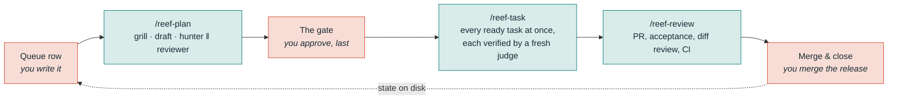

<p align="center">
  
</p>

<p align="center">
  <a href="https://mahmoudmoe.github.io/reef/"></a>
  
  
  
  <a href="https://github.com/MahmoudMoe/reef/actions/workflows/ci.yml"></a>
</p>

<h1 align="center">Reef</h1>

<p align="center"><strong>Run a software project as a graph of gated work. Prove the rules in code.</strong></p>

<p align="center">
  <a href="https://mahmoudmoe.github.io/reef/">Website</a> ·
  <a href="https://mahmoudmoe.github.io/reef/manual/ar/">الدليل العربي</a> ·
  <a href="#install">Install</a> ·
  <a href="#how-it-works">How it works</a> ·
  <a href="#when-it-stops">When it stops</a> ·
  <a href="#settings-reefconfigjson">Settings</a> ·
  <a href="CHANGELOG.md">Changelog</a> ·
  <a href="#for-maintainers">For maintainers</a>
</p>

> *A coral reef grows one calcified layer at a time; each organism leaves a hard structure the next builds on. Reef works the same way: every spec, task, decision and journal line is a layer that outlives the session that wrote it.*

You write a row in a queue. Reef plans it with you, builds it in parallel in isolated worktrees, has a fresh context
verify every task, opens the pull request and closes the row. **You decide twice: you approve the plan and you merge
the release.** Everything in between is decided by code on state the agent cannot write, not by a prompt.

| If you want | Go to |
|---|---|
| To install it and run it on a project | [Install](#install), then [How it works](#how-it-works) |
| To know what it needs, what it never does, and what each stop means | [Before you run it](#before-you-run-it) and [When it stops](#when-it-stops) |
| To change a cap, a model or a branch name | [Settings](#settings-reefconfigjson) |
| To know where a file lives after `/reef-init` | [Layout](#layout) |
| The same, as a page with a pipeline explorer | **[mahmoudmoe.github.io/reef](https://mahmoudmoe.github.io/reef/)** |
| Which rules are code and which are only prose, the measurements, what is next | [For maintainers](#for-maintainers) |

<p align="center"></p>

## Install

In Claude Code (another host: [Hosts](#hosts)):

```
/plugin marketplace add MahmoudMoe/reef
/plugin install reef@mahmoudmoe
```

Then, inside your project:

| You have | Run | What happens |
|---|---|---|
| **A new project** | `/reef-init` | One batched set of questions (your branches, and the architecture grill: host, shape, scale, store, auth boundary, one-year non-goals). Reef renders one tree adapted to your stack: the config, `AGENTS.md`, the constitution, the queue with row 1 = the walking skeleton, the architecture with draft decisions, the journal, a release-only CI, the git hooks. Idempotent: a second run with nothing changed writes nothing. |
| **An existing project** | `/reef-init`, then `/reef-assess` | Nothing you wrote is overwritten: a differing rendering lands in `.reef/proposed/<path>` with a diff and `python3 scripts/reef-init.py --accept <path>` applies the ones you choose. `/reef-assess` reads how the project works and was written, every claim with a proving path, then moves its documents into the tree under one approval. Archive, never delete; one `git revert` undoes it. |
| **A feature to build** | `/reef-plan <row>` → `/reef-task <slug>` → `/reef-review <slug>` | The grill; the spec and the tasks drafted in the feature worktree; the hunter and a fresh reviewer in parallel; then the one question for you, last — nothing after it voids your approval. Every ready task at once, each in its own worktree, each verified by a fresh judge. The PR, the acceptance against the spec, the diff review, the merge and the close. |
| **A queue of rows** | `/reef-loop` | Every ready row through the four commands above, in parallel where rows do not collide. It stops only for your decisions, a missing credential, a wrong spec, or a cap, and batches its questions. |
| **To build without the loop, or to check a new machine** | `/reef-graph` | The same build step `/reef-loop` already uses for every fresh task (graph mode, chosen automatically): implementer, gate and verifier per task as one background workflow, one summary back. Run it yourself only to build a feature without the queue and loop, or once on a new machine to run the probe that proves the guard reaches workflow agents. Never next to a running loop: one orchestrator per project. |
| **The running app attacked** | `/reef-pentest <url>` | One adversary attacks every threat-model row against a live copy of the app, the way a user or a logged-in attacker could; each hole becomes a found queue row. On demand, at any point; needs `/reef-threat` first; only a target you own, never production unless you say so. |
| **Something looks off** | `/reef-doctor` | One screen: the plugin clone's branch and freshness, scripts behind the plugin, the queue's home, worktrees, the loop's state, gh, Docker, waiting proposals — each with its fix. `reef/README.md` is the map of the tree; `.reef/status.html` the live page. |
| **A night delegated to Mahmoud (super Reef)** | `/reef-night` | Mahmoud — your proxy, a chief architect and product manager who decides from your profile (`reef/owner.md`) and your own footnotes — drafts tonight's contract: the rows (by default every ready row of the batch, planned and found; the contract command warns of one left out), the decisions he may take (plan approvals, preview looks — his by default unless a footnote of yours keeps a named look —, product questions, holes after the hunter's rounds, triage), the hard limits (the release to `main`, secrets, money, deletion, Reef's own config, personal data leaving, any row not listed). You approve it once and `/reef-night` starts the runner itself, detached from the session (`reef-run.py --night --detach`): close the session, or Claude Code, and it works on. `python3 scripts/reef-run.py status` shows it from anywhere; `watch` follows it in a terminal. An approval holds 16 hours. In the morning `.reef/night/report.md` lists his decisions (undo: delete or edit) apart from the merges (undo: `git revert`). The release PR is refused while the night runs. A night is heavy: each session runs many Opus agents at once; on a subscription it draws on the plan's usage (the run log's `cost_usd` is the API-price equivalent, not a bill), and `caps.batch_tokens` parks the loop at a budget. Mahmoud runs on Fable — the owner's choice for this role. |
| **A batch without restarting sessions** | `python3 scripts/reef-run.py probe` once, then `python3 scripts/reef-run.py` | Runs `/reef-loop` in fresh headless sessions one after another: at the context ceiling the next session takes over from the handoff. It stops when the loop needs you (your questions land in `.reef/questions.md`; the next interactive `/reef-loop` asks them as one set), stops, parks, leaves work in flight, or hits `--max-iterations` (10). Your terminal shows one line per step — an agent out and back with its verdict, a decision, a merge; `python3 scripts/reef-run.py watch` follows the same lines from another terminal, and `.reef/status.html` shows the last ten. The probe proves the guard denies a headless session's forbidden write first, or it refuses to run. One runner per checkout — the lock does not stop an interactive `/reef-loop` beside it, so run one orchestrator at a time. |
| **A new Reef** | `python3 <plugin>/scripts/reef-update.py --commit` | Pulls the plugin clone, refreshes the project, commits Reef's own files, prints the two Claude Code commands. |
| **A fresh clone** | `make setup` | Hooks are local git config and do not survive a clone. |

<details>
<summary><strong>Upgrading from 0.5</strong></summary>

Re-run `/reef-init`. `scripts/reef-migrate` runs first and adds only keys, keeps `gates.test` as the alias it is, and
writes `.reef/version`. Every check new in 0.6 **warns** on content planned under 0.5 and fails only on content planned
under 0.6. The flat `tasks/` and `docs/` layout keeps working; `python3 scripts/reef-migrate --layout` moves it in one
reviewed commit when you want the tree.

</details>

<p align="center"></p>

## Hosts

Reef runs inside an agent host: the CLI that runs its skills, dispatches its agents and calls its guard before every
command. Claude Code is supported. OpenCode is in early support ([the plan](docs/design/portability-plan.md),
[the live check](docs/perf/opencode-e2e-2026-10-23.md)): the adapter is built and its guard, runner and one loop
iteration are verified live, but no feature has been built and merged on it yet. `<plugin>` below is a clone of this
repository.

| | Claude Code | OpenCode |
|---|---|---|
| Status | supported | early: built and verified live; no feature built on it yet |
| Install | `/plugin marketplace add MahmoudMoe/reef`, then `/plugin install reef@mahmoudmoe` | `python3 <plugin>/scripts/reef-init.py --root .`, then `python3 <plugin>/scripts/reef-opencode.py install`, in the project |
| Start a command | `/reef-loop`, `/reef-plan <row>` and the rest, in the session | the same commands, in an OpenCode session in the project |
| Models | Claude: `opus`, `sonnet`, `fable` | any provider OpenCode reaches: every `roles.*` value is a `provider/model` id; the main session's model is `opencode.json` `model` |
| The model per role | `roles.*` and `tiers.<tier>.roles`, passed on each dispatch and checked by the guard | written into each `reef:<name>` agent file and checked by the guard; a tier table may not vary a role's model (one file, one model) |
| The guard | `hooks/hooks.json` runs it before every shell, edit and dispatch call | `.opencode/plugins/reef-guard.js` runs the same guard before every bash, write, edit and task call |
| Plan and night approval | the question in the session, captured by a hook | the owner, in their own terminal: `python3 <plugin>/scripts/reef-approval.py --owner "<the question>"` |
| At the context ceiling | `/clear`, then the next command the handoff names | a fresh session; the ceiling is not measured |
| The headless runner | `python3 scripts/reef-run.py` (headless sessions) | `python3 scripts/reef-run.py --host opencode`, after `probe --host opencode` |
| Graph mode | one background workflow per graph | not available: each task is its own dispatch (`graph.mode: chat`) |
| The honesty ledger | every row holds | the `portable` rows hold; the six `Claude Code` rows do not |

<p align="center"></p>

## How it works



1. **Plan.** `/reef-plan` grills you, once, about the row. A lean planner then drafts the feature folder in the
   feature's own worktree: a spec with keyed requirements, one decision record with a diagram, and small
   vertical-slice tasks (at most `plan.max_acs` criteria each) whose criteria cite those keys and whose proof is a
   test name or a command. The deterministic check must be green before the planner returns.
2. **Machine review, before you.** The loophole-hunter and a plan reviewer read the draft in parallel, in fresh
   contexts: at most `hunter.plan_rounds` hunter rounds (two) and one fix round by the planner. Only a HALT, two of
   your own documents contradicting each other, reaches you before the gate.
3. **The gate, last.** One question: `Approve plan <slug> at <digest16>?` Your answer is recorded against that exact
   plan. Nothing after it voids your approval: reviewer notes and the ADR status line sit outside the digest, and
   only a HALT ruling or your own decision edits an approved plan.
4. **Build.** Every ready task starts at once, each in its own worktree on its tier's model. A fresh task runs as one
   background workflow where the host has one (graph mode, `/reef-graph`, Claude Code) once this machine's probe has proved the guard reaches workflow
   agents, and so does a fix round (the implementer gets the failure, the verifier judges what it named); without that
   proof it runs in the chat (`/reef-task`). The loop chooses; you don't. Per task: an implementer builds it test-first and hands
   back; a verifier in a fresh context writes its pass or fail rule per criterion *before* reading the diff; a second
   round judges only what the round changed; a hash of the tree proves the judges changed nothing. Three fix rounds
   per task, then it stops and tells you.
5. **Review and merge.** `/reef-review` pushes, opens the PR, checks every proof still holds, runs the hunter once
   on the feature's whole diff, reviews the result against the spec, drives CI green, and records a green verdict
   tied to the exact commit. A merge is allowed only against that record. By default you merge the feature PR.
6. **Close.** Decision records get their final numbers, the row moves to the archive with your words, the journal
   gets a line with what was measured and what the row cost, and `HANDOFF.md` is rewritten whole. A release PR
   runs the release gates once, and you merge it.
7. **Resume anywhere.** Everything is on disk. A new session, or a fresh one at the context ceiling (`/clear` in Claude Code), reads the handoff head and one
   status tick, which names the next command and the files behind every id, and continues every row from its
   last completed step. `.reef/status.html` is the same picture as a page; `reef/README.md` is the map of the tree.

<p align="center"></p>

## Before you run it

**What it needs**

- **macOS or Linux. On Windows, run Claude Code inside WSL2.** Native Windows is not supported: the guard needs file
  locks, a signal timer and process groups that Windows does not have, so inside a Reef project it stops and says so.
- Claude Code with the plugin installed from the marketplace. [Hosts](#hosts) says what another host changes.
- `python3` on the PATH. The guard is Python; without it a dispatch is denied.
- git with the hooks installed: `make setup` after every clone.
- `gh` logged in, for the review, record and merge steps. Without it Reef stops with `USER ACTION REQUIRED` and lists
  the exact commands it would have run.

**What it never does**

- Overwrite a file you wrote. A differing rendering goes to `.reef/proposed/` with a diff; only `--accept` applies it.
- Delete a document. Recalibration archives into `reef/archive/<date>/` in one commit that one `git revert` undoes.
- Let a judge write. The verifier, the adversary and the plan reviewer are read-only, and a tree hash proves it.
- Merge the release. The release PR is yours. There is no gate on push by design; CI is the wall.

**What you accept**

- Two human gates and nothing between them: the plan approval, last, after the machines have reviewed the plan,
  and the release merge. Nothing after your approval voids it except a HALT you rule on yourself. In a super Reef
  night you approve one contract instead, and your proxy approves plans inside it, each decision recorded as his;
  the release still waits for you in the morning.
- A row costs real tokens: planning, review, the task graph and the close are separate sessions, each on its tier's
  model. On a subscription that is plan usage, not an invoice.
- A forge is part of the loop: review verdicts are records tied to the PR head on GitHub. Without a remote, the loop
  hands the merge to you.

<p align="center"></p>

## When it stops

| You see | It means | You do |
|---|---|---|
| `Approve plan <slug> at <digest16>?` | The one question of a feature, asked after the machine review. The approval is recorded against that digest; reviewer notes and the ADR status line sit outside it. | Answer *Approve*, or say what to change; the planner amends, the machines re-check, and you are asked again. |
| `awaiting: <feature> (machine review (hunter ‖ plan reviewer) before the gate)` in the tick | The draft has no review pass or no hunter pass at its current digest. | Run `/reef-plan <slug>`; it picks the feature up at the review. The tick will not offer its tasks until then. |
| `awaiting: <feature> (hunter plan pass stale on <task>: …)` | A review-round edit moved the digest after the hunter passed. | A re-check within `hunter.plan_rounds`, or rule on the open hole yourself with the `--decided` command the line prints. |
| `HALT` from the plan reviewer | Two of your own documents contradict each other. The reviewer does not pick a winner. | Decide which one is right; the planner amends and the machines re-check. |
| `dispatch (graph): 101, 102 — python3 scripts/reef-graph-run.py generate` | Several tasks are ready and this machine's probe recorded `GATE OK`. | Nothing: `/reef-loop` runs them as one background workflow and settles the results. |
| `verify now: <id> (handed back, uncommitted — gate + verifier, no implementer)` | An implementer handed the task back and nothing judged it yet. | Nothing: `/reef-loop` judges it (in the graph when this machine's probe passed, else `/reef-task` from the gate). |
| `BROKEN: graph.mode is graph but this machine has no GATE OK` | You asked for graph mode and the probe has not proved the guard reaches workflow agents here. | `python3 scripts/reef-graph-run.py probe` once, then the probe-check it prints; chat mode runs meanwhile. |
| `GROWTH over caps.task_growth: <ids> — say why in the journal` | A task cost the orchestrator more context than the cap you set. | Say why in the journal row, or split the task next time. |
| `USER ACTION REQUIRED` with a list of commands | No remote, or no `gh` login. Reef does not guess at a forge. | Run the listed commands yourself, then the next command the handoff names. |
| `/clear now` and a fresh `HANDOFF.md` | The session's context reached the ceiling, or has no room left for a new task. State is on disk. | Start a fresh session (`/clear` in Claude Code). The next session continues every row from its last completed step. |
| The guard denied a dispatch | Outside the ready set, over the retry cap, the wrong model for the tier, no approval or review record, or a hand-back or report the orchestrator wrote itself. The message names which. | Fix the named cause. Nothing was dispatched and no marker was written. |
| The guard denied a command | A gate bypass (`--no-verify`, `hooksPath`, a stash, a gate piped into `tail`), a hand-written approval or record, or a protected file outside a critical task. | Do it the gated way. If the rule itself is wrong, that is a `critical` task, not an edit. |
| A gate exited `124` | It ran past `gates.timeout_s` and was killed with its process group; a leaked dev server is the usual cause. | Find what held the port, or raise the timeout for that gate. |
| The loop parked | Identical ticks with nothing in flight, or a feature or batch token budget reached. | `scripts/reef-watch` shows what happened while nobody was in the room. Change the queue, the cap, or the budget. |
| The tick names stale `found` rows | Rows filed two batches ago that nobody admitted. | `python3 scripts/reef-queue.py triage`: one question per module, admit or drop with a reason. |
| A check warns instead of failing | Content planned under 0.5 meets a rule new in 0.6. | Nothing. The rule fails only for content planned under 0.6. |
| `Not verified in a browser:` in a verifier report | The judge could not open the app; it says so instead of claiming. | Check that part yourself, or give the task a browser proof row. |
| `Approve night <YYYY-MM-DD> at <digest16>?` | The one question of a super Reef night: tonight's rows, the decisions your proxy may take, the hard limits. The approval is recorded against that contract and your profile. | Answer *Approve*: `/reef-night` starts the runner itself and gives its pid; or *Edit* the contract and be asked again. |
| `the contract was approved …, more than 16 h ago: that was another night's — run /reef-night for tonight` | An approval covers one night: 16 hours from your *Approve*, and a contract whose rows are all closed is refused too. | Run `/reef-night` and approve tonight's contract. |
| `reef-run: waiting on you — …` and `your questions: .reef/questions.md` | The headless runner reached a question only you can answer, and stopped. | Run `/reef-loop` in an interactive session; it asks the open questions as one set and continues. |
| `release PR into <release> at <sha>: no PASS security record for that commit` | The release's security pass has not run on this exact head, or the base moved since it did. | Let the loop run `reef:security` on the release diff and record it; the PR opens on a PASS at the head. |
| `a super Reef night is running (.reef/night/active): the release … is the owner's, in the morning` | A delegated night holds the release: Mahmoud may merge features, never the release. | Nothing tonight. Read `.reef/night/report.md` in the morning, then release yourself. |
| Something looks off and you cannot say what | Two `AGENTS.md`, scripts behind the plugin, a plan nobody can find, a stuck worktree. | `/reef-doctor`: one screen, each finding with the command that fixes it. |

<p align="center"></p>

## Who runs what

| Role | May write? | Does | Runs on |
|---|---|---|---|
| Orchestrator | dispatches | Your main session: reads one tick, starts the ready work, never writes code or evidence itself. In graph mode it supervises one workflow's summary instead of one agent result per turn. | your session |
| Planner | writes plan files | Drafts or amends one feature's spec, tasks and draft ADR in the feature worktree, lean, and returns only when the deterministic check is green. Never approves, never reviews, never writes code. | the tier's planner model |
| Implementer | writes code | Builds one task test-first in its own worktree; never commits, never judges its own work. | the tier's author model |
| Verifier | read-only | Decides its pass or fail rule per criterion before reading the diff; reports evidence per criterion; from the second round judges only what the round changed. | the tier's verifier model |
| Loophole-hunter | read-only | The adversary: on a `critical` plan before code (at most two rounds), and once per feature on the finished diff before the green record. | the tier's adversary model |
| Plan-reviewer | read-only | Reads a drafted plan for drift between spec, decisions, tasks and config, before you see it; halts on a contradiction between two of your own documents. | the tier's reviewer model |
| Mechanic | writes, no claims | Rebase, run the gates, re-take a measurement, archive edits. Exit codes and diffs, never prose. | the cheapest model |
| Mahmoud | read-only | Only in a super Reef night: the owner's proxy, deciding inside the contract the owner approved — plan approvals, design looks, product questions, holes after the hunter's rounds, triage. Never a hard limit; never outside the contract. | `roles.proxy` (Fable, the owner's choice) |
| Security | read-only | Once per release: audits the release's diff against the threat model and the constitution, then argues what a scanner cannot reach (untrusted input, the authenticated attacker, the deployment surface). Its verdict is a record; the release PR opens only on a PASS at its head. | `roles.security` |

The tier decides which model does the work, which model judges it, and how hard they try. You declare it on a task;
the paths it touches can only move it up.

| Tier | When a task is this tier | Judges | Author | Effort | How it is checked |
|---|---|---|---|---|---|
| `critical` | First-time analysis, architecture, the constitution, the threat model, `touches: money\|pii\|auth`, the guard's own paths. | opus | opus | high | judge; the hunter on the plan (two rounds) and on the feature's diff |
| `design` | Two people would build it differently; a mechanism that failed twice; auth, crypto, secrets, migrations. | opus | opus | high | judge; the hunter on the feature's diff (`hunter.plan_pass: design` adds the plan) |
| `full` | The default. | opus | opus | medium | judge; the hunter on the feature's diff |
| `light` | Allowlisted paths (`docs/**`, `README.md`), no risk path, under the line ceiling. | none: the deterministic check alone stamps | opus | low | gate and golden test, no judge |

The model names are Claude Code's defaults. Change the model per role and tier in `.reef/config.json` under `tiers.<tier>.roles`; a project with no tier table gets
one model per role (`roles.*`).

<p align="center"></p>

## Settings (`.reef/config.json`)

Every cap, model, branch name and path Reef uses is a key in this one file, written by `/reef-init` and yours to edit.

| Key | Default | Effect |
|---|---|---|
| **`gates.timeout_s`** | `1200` | a gate past this many seconds is killed with its process group and exits 124 (0 = none) — 2026-10-18: a leaked dev server held the graph-mode workflow three hours |
| `gates.fast` / `gates.full` / `gates.extra` / **`gates.release`** | `""` / stack test / `{}` / c4 drift + gitleaks + the stack's audit (new project; proposed on upgrade) | commit gate / verify, review, CI / other gates / release-branch gates (`reef-ci-local.sh --release`; a missing tool is exit 77 = skipped = exit 2) |
| `caps.attempts` | `3` | fix rounds per task, and per item on its rollup |
| **`plan.max_acs`** | `0` (warn above 8) | the criteria a task may carry; set `8` at a batch boundary and `reef-plan-check` fails a bigger task (split it). `0` in the template because `reef-init` adds new keys to an existing project's config, and a running batch may hold an approved 21-criterion task. |
| **`caps.task_growth`** | `0` (off) | the orchestrator's context growth a task may cost, summed over sessions (`.reef/cost/tasks.json`, written by the Stop hook from the transcript); the tick names every task over it and the journal row says why. Set it from the median of ten measured tasks × 2, not from a guess. |
| **`caps.dispatch_reserve`** | `30000` (new project); `0` (off) | room that must be left under `caps.context_tokens` for an **implementer** dispatch (a new task starting): under it the guard checkpoints (HANDOFF.md) and denies with "/clear NOW"; judges and mechanics stay allowed to the ceiling and finish the task in hand. First contact: a task started at 126k of 150k was split across two sessions. |
| **`caps.context_tokens` / `caps.context_warn`** | `150000` / `100000` (new project); `0` / `0` (off) on a migrated 0.5 project | the dispatching session's context ceiling / warning. Set from the measured rows (`docs/perf/dogfood-2026-10-16.md` §E): session maxima 58k–159k, p90 148k, so the warning fires late in a planning or critical-row session and the ceiling only on a runaway; a 60%-of-window ceiling would have cut the critical row in two. Tighten per project if its rows are smaller |
| **`caps.feature_tokens` / `caps.batch_tokens`** | `0` / `0` (off) | token budgets the tick checks; over one, the feature or batch parks |
| **`tiers.<tier>.roles` / `.effort` / `.paths`** | the table above; design paths auth/crypto/secrets/migrations; critical paths `.githooks/**`, `scripts/reef-*`, `hooks/**`, `.reef/config.json` | model per role, effort, path classes that force the tier |
| `tiers.light.allow` / `max_lines` / `migrations` | `docs/**, README.md` / `80` / migration dirs | what may be light |
| `graph.parallel` · `resources.<name>.slots` · `worktree.dir` / `worktree.setup` | `10` · `1` (`heavy` 2) · `.reef/worktrees` / stack install | as in 0.5 |
| **`graph.mode`** | `auto` | `auto`: a fresh `dispatch now` task runs as a workflow (`/reef-graph`) when this machine's probe recorded GATE OK, in chat (`/reef-task`) otherwise; `chat`: never; `graph`: as auto, a missing gate is BROKEN. A fix round and a `verify now` run in the graph too (a judge-only pipeline for a hand-back or a rejected report). Read from the main checkout, like `hunter.*`. |
| `roles.*` | author opus · verifier opus · plan_reviewer opus · planner opus · adversary opus · reviewer opus · security opus · proxy fable · mechanic sonnet | the fallback when the tier table does not name the role |
| `merge.by` · `ci.feature_gate` · `branches.base` / `branches.release` | `human` · `ci` · `main` / `main` (init: `develop` / `main`) | as in 0.5; `ci.check_name` (`every gate, once`) names the required check for `reef-repo` |
| **`paths.features`** · `paths.tasks` / `adr` / `glossary` / `runlog` / `queue` | `reef/features` (0.6 tree) · 0.5 locations for a 0.5 project, `reef/…` for a 0.6 one | where things live; the loaders accept either shape |
| **`queue.home`** · `queue.batch_max` | `file` · `10` (a new project on GitHub: `issues`, unless `/reef-init` was told `--queue file`) | `issues`: rows are this repository's issues labelled `reef-row`, titled `[<id>] <item>`; a batch is a milestone; `reef-queue.py migrate-to-issues` moves a file queue |
| `plan.test_re` / `plan.max_words` / **`plan.max_tasks`** | `""` / `0` / `12` | test-name override / task word cap / split a feature above this |
| **`hunter.plan_rounds`** / **`hunter.plan_pass`** / **`hunter.guard_pass`** / **`review.diff_review`** / **`plan.external_api_re`** | `2` / `critical` / `feature` / `off` / `""` | hunter rounds on a plan (0 = no cap) / which tiers' plans the hunter passes before code (`critical`, or `design` for both) / the hunter's guard pass once per `feature` before GREEN (or per `task`) / the per-feature diff review (`on`/`off`; `review.split_lines` 4000) / a task naming an external API without a doc or version in `resources:` is a WARN |
| `writing.task_words.<tier>` · `handback_words` · **`report_words`** · `journal_words` / `queue_words` · **`sentence_words`** / **`criterion_words`** · **`session_start_tokens`** | `0` everywhere (off; 0.7 — a budget rejected honest hand-backs and reports into rewrite rounds; set a number to enforce) · `40000` / `35000` · `8000` | caps; `task_words`, the sentence and criterion rules fail only under 0.6 |
| **`loop.inflight_stale_minutes` / `loop.no_progress_ticks`** | `90` / `3` | an in-flight marker older than this is "returned"; identical ticks before the loop parks |
| **`context.failure_lines` / `context.explore_files`** | `60` / `40` | the failing block's cap; (the Read tripwire was cut — the key is reserved); an Explore agent's file budget |
| **`converge.test_cmd`** | `""` | how `reef-converge` runs one named test (`{name}`); empty = the full gate once |

0.5 configs keep working: `gates.test` is an alias of `gates.full`; every new key defaults to the old behaviour;
`scripts/reef-migrate` adds the keys once.

<p align="center"></p>

## Layout

One tree, grouped by feature; machine state in `.reef/`; three files at the root; tooling where git and CI expect it.
```
AGENTS.md  CLAUDE.md (pointer)  HANDOFF.md                 # root: the three files every agent meets first
.reef/                                                      # config and machine state
  config.json  version                                      #   committed
  loop.json  inflight/  verifying/  review/  approvals/  worktrees/  proposed/  ci-local/  hunt/  cost/  graph/  status.html   # gitignored
  run/  night/  questions.md                                #   the runner's gate, log and lock; a night's contract, approval and report; your open questions
reef/                                                       # every committed Reef artifact
  README.md                                                 #   the map of the tree, rendered by reef-init
  owner.md                                                  #   your profile, the proxy's brief for a delegated night
  constitution.md  queue.md  queue-archive.md  journal.md  glossary.md  day-zero.md  recalibration.md
  architecture/   architecture.md  conventions.md  workspace.dsl  context.md  container.md  threat-model.md
                  adr/NNNN-<slug>.md                        # project-wide decisions only (stack, hosting, boundaries)
  features/       README.md                                 # generated index of features (never hand-edited)
    <feature-slug>/                                         # one folder per queue row, named by the feature
      SPEC.md                                               #   the intent, end to end, FR keys by layer
      specs/<part>.md                                       #   child specs, big features only
      adr/NNNN-<slug>.md                                    #   this feature's decisions, with diagram
      tasks/NNNnn-<slug>.md   tasks/done/                   #   the plan; ids global; rollup lives here too
  archive/<date>/
scripts/reef-*   .githooks/   .github/workflows/ci.yml      # tooling where git and CI expect it
```

The plugin itself: `skills/` (init, assess, explore, loop, plan, plan-review, task, graph, verify, review, c4, threat, pentest,
doctor, night) · `commands/` · `agents/` (implementer, verifier, plan-reviewer, loophole-hunter, mechanic, planner, security,
mahmoud) · `scripts/` (`reef-init.py`, `reef-update.py`, `reef-doctor.py`, `reef-run.py` [probe|contract|watch|--night], `reef-graph-run.py` [probe|generate|settle],
`reef-migrate`, `reef-loop.py` [tick|start|stop|wait], `reef-handoff`, `reef-gate.sh` [fast|full|--failures],
`reef-attempt`, `reef-guard.py`, `reef-approval.py`, `reef-record`, `reef-graph.py`, `reef-plan-check.py`
[--rules|--digest|--needs-agent|--verify-stamp], `reef-converge`, `reef-adversarial`, `reef-claims.py`
[check|--handback|report|claims-only], `reef-tier.py`, `reef-queue.py` [status|ready|check|adr-number|index|footnote|add-row|set-depends|triage|set-batch|drop-row|close|admit|set-priority|demote|migrate-to-issues],
`reef-structure`, `reef-recalibrate`, `reef-repo`, `reef-c4.py`, `reef-threat.py`, `reef-ci-local.sh` [--ci|--release],
`reef-snapshot.sh`, `reef-cost.py`, `reef-watch`, `reef-eval`, `reef-guard-profile.py`) · `hooks/hooks.json` (PreToolUse Bash ·
Task|Agent · Edit|Write|MultiEdit; PostToolUse AskUserQuestion; Stop; SessionStart) · `migrations/` ·
`schemas/task.schema.json` · `templates/` (config, task, spec, adr, glossary, runlog, pre-commit, stacks/, project/) ·
`tests/eval/` (the corpus) · `tests/fixtures/payloads/` · `docs/perf/`

<p align="center"></p>

## For maintainers

### What is enforced, and how (the honesty ledger)

Classes: **code** decides on structured state the agent cannot author · **tripwire** matches command text (a blocklist
over a shell surface is never complete; CI is the wall) · **prose** lives in a skill or agent file. Every `scripts/reef-*`
carries `# CLASS:` in its header and `tests/test_contracts.py` ties each row below to a script of that class.
Host: **portable** when a script, git or the guard's checks enforce the rule, which OpenCode reaches through its
adapter (`scripts/reef-opencode.py`) · **Claude Code** when it needs a hook event or a payload only Claude Code sends.

<details>
<summary><strong>The ledger</strong>, rule by rule</summary>

| Rule | Enforced by | Host | Layer |
|---|---|---|---|
| Retry cap / same-failure-twice | `reef-attempt` (data) + `reef-guard.py` deny at dispatch + `dispatches:` odometer | portable | **code** |
| No implementer outside the READY SET — one graph across every feature folder (`blocked-by`, `resources:` slots, `graph.parallel`) | `scripts/reef-graph.py` computes it; the guard imports the plugin's own copy, takes one lock keyed on `paths.features`, denies, and on allow marks `in-progress` and writes `.reef/inflight/<id>` | portable | **code** — launching every ready task is reef-task prose; the Stop hook catches the missing dispatch at turn end |
| The missing dispatch (loop active, ready work, nothing in flight, no wait, no stop reason) refuses the turn's end — once per tick state | `hooks.json` Stop → `reef-guard.py` → `scripts/reef-loop.py tick --assert-no-idle`; `stop_hook_active` honoured | Claude Code | **code** (at turn end) |
| Every role runs on its TIER's model (`tiers.<tier>.roles.<role>`, then `roles.*`); an all-light plan needs no plan-reviewer | `reef-attempt` prints `author:`/`verifier:`/`adversary:`; `reef-plan-check.py --needs-agent`; the guard resolves the tier from the `REEF-TASK:`/`REEF-FEATURE:` line on every dispatch and denies a mismatch | Claude Code | **code** |
| The plan reviewer's verdict is a record bound to the plan's digest; a feature with a task above `light` dispatches only on a `PASS` at the current digest | `scripts/reef-record plan-review`, `reef-plan-check.py --verify-stamp` (`review: MISSING \| STALE \| FAILED`), the guard at dispatch | portable | **code** |
| Plan approval is the HUMAN's — or, during a super Reef night the owner approved, Mahmoud's (the owner's proxy), recorded `by: mahmoud (proxy)` — bound to the plan's digest; an edit afterwards approves nothing | `/reef-plan` asks `Approve plan <slug> at <digest16>?`; the PostToolUse hook `scripts/reef-approval.py` writes `.reef/approvals/<slug>.json` only on `Approve` with the current digest; `reef-plan-check.py --verify-stamp` and the guard require it (0.6-planned features; older ones warn) | Claude Code | **code** (the result shape is schema-verified: headless sessions exclude AskUserQuestion, see `docs/perf/payloads-2026-10-16.md`) |
| Nobody writes an approval or a review record by hand | `reef-guard.py` denies Bash writes and Edit/Write/MultiEdit under `.reef/approvals/`, `.reef/review/` | portable | **tripwire** |
| An agent never runs `reef-approval.py` except `--proxy` (a night); where no approval hook exists (OpenCode) the owner approves in their own terminal, `reef-approval.py --owner "<question>"`, at the plan's current digest | `reef-guard.py` matches the command; `reef-approval.py --owner` takes the hook's own path | portable | **tripwire** (an agent's own code writing the record meets the record-directory tripwire above) |
| The release PR (`gh pr create` into `branches.release`) opens only on a PASS from `reef:security` recorded at the exact head it proposes (a PR from the base with no `--base` is treated as the release PR); a base that moved since the pass is audited again. A security record never opens a feature merge (it stores `head`, not `sha`). No rule when base == release. A PR opened in the forge's web UI is outside every hook | `scripts/reef-record security` (the agent's own VERDICT line, `report_sha256`); `reef-guard.py` `check_release_pr`; `tests/test_record.py::SecurityPass` | portable | **code** for the loop's path |
| Review verdicts are RECORDS bound to the forge head; `gh pr merge` only against a GREEN record (clean base merge or claims-only commits are the only carry-overs; rebase, code push, slow or failed gh deny) — `merge.by: loop` only | `scripts/reef-record` (`gh pr view`, `gh api …/git/commits`); `reef-guard.py` on `gh pr merge` / `gh api …/merge` under its own gh deadline | portable | **code** (presence) |
| Judges are read-only: verifier, loophole-hunter, plan-reviewer, Explore get no mutating git, no Bash write, no CI wait; a typeless sub-agent is locked while `.reef/verifying/<id>` exists; no sub-agent waits on CI or sleeps a minute | `reef-guard.py` reads `agent_type`/`agent_id` from the payload (verified live, 0.0); the snapshot hash is the backstop | portable | **code** + **tripwire** (the write detection is a token match) |
| A hung guard denies; no python3 denies a dispatch | `signal.alarm` deadline inside the guard; `timeout` + `onFailure: block` on every PreToolUse matcher (`scripts/reef-guard-profile.py` sets them at ≥ 5 × p95) | portable | **code** |
| The guard's own files and the `roles\|caps\|gates\|tiers` keys change only under a `critical` task in flight or inside Reef's own repository | `reef-guard.py` Edit/Write/MultiEdit matcher (JSON diff of the protected keys) and Bash write detection; `reef-init --accept` stays allowed | portable | **code** for the keys, **tripwire** for the Bash shapes |
| Plan edited after approval → re-review; the stamp covers the WHOLE feature folder (spec, child specs, ADRs, tasks) | `reef-plan-check.py --verify-stamp`, per feature, re-checked by the guard at every dispatch against the task file's own worktree | portable | **code** |
| A feature folder is well-formed: a descriptive slug, `SPEC.md` with `Row:` and layered `FR-n` keys, child specs with `Parent:`, ACs citing keys of their own folder, ≤ `plan.max_tasks` tasks, nothing else inside | `reef-plan-check.py` (`--rules` prints every rule with the project's numbers); `reef-queue.py check` (structure, slug); `reef-structure --check` | portable | **code** |
| Criterion and proof split (new shape): one declarative sentence ≤ `writing.criterion_words`, its proof in the `## Proof` row; old shape stays valid; sentences ≤ `writing.sentence_words` | `reef-plan-check.py` (fails under 0.6, warns older); the claimed-twice check reads Proof rows | portable | **code** |
| Every Proof row holds on the branch before acceptance (`missing` / `contradicts` under the one cap) | `scripts/reef-converge <feature>` | portable | **code** when run (reef-review prose) |
| A tier only gets heavier: path classes (`tiers.design.paths`, `tiers.critical.paths`) and `touches:` (pii/money/auth → critical, migration → design + `Rollback:`) | `scripts/reef-tier.py` from the diff; `reef-plan-check.py` on the declaration; `reef-init` lists older tasks the rails would move | portable | **code** when run |
| Adversarial pass on the PLAN before code and on the finished GUARD before close (`design` and `critical`) | `scripts/reef-adversarial` records a PASS bound to the plan's content (`BLOCKER: none` is no blocker; a bold one is); the guard refuses a dispatch without it; the pre-commit refuses a design/critical task entering `done/` without `adversarial-guard:` | portable | **code** |
| A critical `touches: auth\|pii\|money` task needs a threat model at least as new as the architecture | `reef-plan-check.py`; `scripts/reef-threat.py lint\|fresh` (every boundary crossing has a mitigated or accepted STRIDE row) | portable | **code** |
| The architecture model is generated from code with a proof per element; drift is element-level, once per release | `scripts/reef-c4.py generate\|lint\|--diff` as `gates.release.c4`; `reef-ci-local.sh --release` | portable | **code** |
| Hand-backs ≤ `writing.handback_words` with a claims list; verifier reports carry `RUN:`, one `RULE AC<n>` per criterion citing its Proof row, evidence per AC; hunter reports carry `DEFECT`, cited `BLOCKER`s, `VERDICT`; every report ≤ `writing.report_words`; a fix round's claims point inside its own diff; after GREEN only claims-only commits | `scripts/reef-claims.py check --handback` / `report` / `check <range>` / `claims-only` | portable | **code** when run (reef-task prose) |
| One cap per item after GREEN (acceptance + diff + CI share it); one rollup per feature | `reef-attempt` and the guard refuse a second rollup | portable | **code** |
| Draft ADRs in parallel branches, numbered at merge in ONE global sequence across `reef/architecture/adr/` and every feature `adr/`; path citations stay files | `reef-queue.py adr-number`; `reef-plan-check.py` exempts `draft-*.md` | portable | **code** |
| The tick never advertises a task whose plan lacks the human's approval at the current digest or a fresh review stamp: it is `awaiting: <feature> (approval \| re-approval \| plan review)` | `scripts/reef-loop.py tick` runs `reef-plan-check.py --verify-stamp --feature` per ready feature | portable | **code** |
| Queue status has one home (the task files, a folder's `SPEC.md Row:` links slug to row); `reef/features/README.md` is generated | `reef-queue.py status\|ready\|check\|index` | portable | **code** |
| The queue on the project's issues (`queue.home: issues`): a row is an issue titled `[<id>]`, a batch a milestone; every read syncs a snapshot, every write fails closed; a dropped row is not done | `reef-queue.py` · `tests/test_queue_issues.py` | portable | **code** |
| Context ceiling: a dispatch over `caps.context_tokens` is denied and the guard itself renders `HANDOFF.md` from measured state first ("/clear now"); from `caps.context_warn` the hook warns the model | `reef-guard.py` on Task/Agent via `scripts/reef-cost.py --live` on the payload's `transcript_path` (tail only), then `scripts/reef-handoff --write` | Claude Code | **code** (defaults set from the measured rows; 0 = off on a migrated project) |
| What happened while nobody was in the room: the tick, tasks by status and attempts, journal rows since a date, found rows, stops, sessions with per-feature growth, rejected judge reports — one screen, no model | `scripts/reef-watch [--since] [--json]` | Claude Code | **code** (a report, not a gate) |
| `/reef-assess` writes data, not an essay: the observed sections present, every claim `Observed — path:line` or `Inferred`, the harnessability table's five dimensions summing to its heading | `scripts/reef-claims.py assess` (fixture: the real ledger report) | portable | **code** |
| The queue has one home — `paths.queue` on `branches.base` in the main checkout; a feature branch whose queue differs from its fork point fails the plan check | `reef-plan-check.py` queue-home check; `tests/test_feature_spec.py::QueueHasOneHome` | portable | **code** |
| No-progress parking (`loop.no_progress_ticks` identical ticks, nothing in flight) and token budgets (`caps.feature_tokens`, `caps.batch_tokens`) | `scripts/reef-loop.py tick` | portable | **code** |
| Reports, never raw material: the exit code plus the failing block (`context.failure_lines`), the whole log on disk | `reef-gate.sh --failures`, `reef-ci-local.sh` (truncation inside the gate keeps the exit code) | portable | **code** |
| Session start under `writing.session_start_tokens`: the handoff head + the tick + the next command, nothing else read | `hooks.json` SessionStart → `reef-loop.py tick --session-start --hook`; `AGENTS.md` ≤ 80 lines and the skills' re-entry sections (contracts) | Claude Code | **code** for the cap, **prose** for what the model then reads |
| Commit gate tests the index, outside git's hook environment (`GIT_DIR`, `GIT_INDEX_FILE`, `GIT_WORK_TREE`, `GIT_PREFIX`, `GIT_CONFIG_PARAMETERS` unset, so a suite's own git fixtures never touch the real repository) | `.githooks/pre-commit` (+ `pre-merge-commit`) | portable | **code** |
| Local CI = CI, every exit code read; a skip is exit 2, not success; `gates.release` run on release-branch PRs only | `scripts/reef-ci-local.sh [--ci] [--release]` | portable | **code** |
| Repository protection (release branch protected, push protection, CODEOWNERS), idempotent | `scripts/reef-repo` | portable | **code** when run |
| Documents live in the layout; recalibration archives, never deletes, in one revertable commit with links rewritten | `scripts/reef-recalibrate plan\|--apply\|history`; `scripts/reef-structure --check` (both layouts) | portable | **code** |
| Migrations are versioned and idempotent; a gap refuses | `scripts/reef-migrate` + `migrations/<from>-to-<to>.py` | portable | **code** |
| `git stash`; a gate piped into `tail`/`grep`; bypass spellings (`--no-verify`, `-n`, hooksPath, env smuggling, `rm .githooks`) | `reef-guard.py` (tokenizing) | portable | **tripwire** — CI is the wall |
| Push gate | none by design — a worktree gate at push time only false-rejects | portable | **CI is the wall** |
| Verifier didn't touch the tree | `reef-snapshot.sh` before/after (nested worktrees excluded) | portable | code hash, **prose trigger** |
| Verifier writes its pass/fail rule per AC before reading the diff; attacks the last round's fix first; the four kinds that fail (regression, bypass, correctness, failed AC — all else NIT); browser evidence or `Not verified in a browser:`; "cannot verify here" needs the probe; the hunter lets the Scope draw the BLOCKER/NEW-ROW line | reef-verify / verifier / loophole-hunter text, under the eval (`scripts/reef-eval`) | portable | **prose** (measured: `docs/perf/eval-baseline-2026-10-16.md`) |
| Explore agents label every claim Observed (with a proving path) or Inferred | reef-explore / reef-assess text; the lock above is the mechanism | portable | **prose** |
| `/reef-init` never overwrites, idempotent, one home per fact, release-only CI | `scripts/reef-init.py` (`test_init.py`) | portable | **code** |

</details>

### The adversarial stage

The `loophole-hunter` runs on a `critical` plan before code (`hunter.plan_pass`; at most `hunter.plan_rounds` = 2
rounds, enforced by the recorder: a hole still open after that is the owner's decision at the gate, `--decided`), and
once per feature on the finished diff before the GREEN record (`hunter.guard_pass: feature`; `task` for one pass per
task), with one question: *how can every check be green while the defect happens?*; on demand, `/reef-pentest` runs
it as `pass=system` against the threat model and the running app. Read-only by the guard, cites file:line, ranks holes by
whether they will happen here and by their real cost, attacks the last round's fix first, and lets the task's Scope
draw the line between a BLOCKER and a NEW-ROW. BLOCKER fails the pass under the cap; NEW-ROW becomes a queue row.
`scripts/reef-adversarial` records only a PASS without a blocker. Never on `mech`.

Measured on Reef's own code (the 0.7 dogfood): the hunter rejected the plan of a 60-line task six times, each time on
a real defect found by probing the transcripts on disk, and accepted the seventh; on the finished code it passed with
seven NEW-ROWs. Its eval: catch-rate 1.00, precision 1.00, false-FAIL 0.17 at k=3 over the whole corpus.

### Measured

Every claim above has a number behind it, and the numbers live in `docs/perf/`:

- **`2026-10-18.md`** — batch 2 on the trial project: four critical tasks by task and by agent run (≈ 25 runs, the
  hunter's ~40k floor, 145k implementers, an orchestrator as expensive as its implementer), the verifier-FAIL drill
  as it happened (202: hunter BLOCKER → one-test round → PASS), the first graph-mode task, the 0.7 targets.
- **`dogfood-2026-10-16.md`** — Reef run end to end, headless, on a fresh Python project (six stages: init 11k, plan
  66k, plan review 25k, task graph 63k, review 54k, close 39k of orchestrator context growth; the CLI it built works) and
  on a clone of itself (one critical-tier row, 111k). Seven defects in Reef found by the run, each fixed with a test
  shown red first. `scripts/reef-cost.py` reports per-feature growth (`rows`), a feature Reef built on itself.
- **`baseline-2026-10-16.md`** — the 0.5 session the 0.6 targets were set against: first turn 91k tokens, 43% of
  context attachments, 31% raw Bash output.
- **`eval-baseline-2026-10-16.md`** — `scripts/reef-eval` on the frozen corpus, k=3: every true blocker caught by every
  agent; the verifier's false-FAIL 0.33 → 0.00 (0.6), the hunter's 0.33 → 0.17 (0.7), nothing dropped; the corpus's own
  PASS fixtures were wrong three times and the agents were right each time.
- **`payloads-2026-10-16.md`** — the hook payloads Reef relies on, captured from live Claude Code sessions, with what
  was and was not verified.
- **`guard-profile-2026-10-16.md`** — p95 per hook matcher (≤ 130 ms); every hook timeout ≥ 5 × p95.
- **`docs/design/plan-cost.md`** — where a planning session's tokens go and the cuts (a fifth went to reading the
  checker's source; `reef-plan-check.py --rules` replaces that read).

### Selftests

`sh tests/run.sh` — 558 sabotage and contract tests (453 Python + 105 shell, as the suite runs them). Every mechanism in
this plugin has a test here that shows it going RED on the defect it exists to catch (each suite is listed in
`tests/run.sh`); CI runs them on ubuntu (dash — the honest POSIX check) and macos, and a change to a `CLASS: code`
script without a `tests/` change fails the PR. The live eval (`scripts/reef-eval run`) needs the CLI and credentials
and never runs in CI; its fixture replay does.

### Status and what is next

Reef 0.7.0 is the released version, in daily use on a trial project; every entry under "0.7.0" in `CHANGELOG.md` names
the first contact that caused it, and `docs/perf/` holds the measurements. What 0.7 brought (`docs/design/workflow-v2.md`): the owner's gate last, after the hunter and
the plan reviewer run in parallel on the draft; a lean planner; tasks capped by criteria; graph mode (`/reef-graph`,
gated by a probe of the guard); one command to update (`reef-update.py`), one screen to diagnose (`/reef-doctor`), a
map of the tree and a status page; found-row triage; the cost of every task in the record; defaults sized like the
field (word budgets off, the hunter's guard pass once per feature); the outer runner (`reef-run.py`: the loop in fresh
headless sessions, so you are not the restart button); the release's security pass as a recorded verdict the release
PR needs; `/reef-pentest` against the running app; super Reef, one delegated night under Mahmoud, your proxy, inside a
contract you approve once, started by `/reef-night` itself; and OpenCode in early support (`scripts/reef-opencode.py`).

Open: a release drill to `main` through the whole chain, a live capture of the AskUserQuestion payload, a sonnet
author for the `light` tier once an author eval exists.

The plan after first contact for ease of use and autopilot maturity: [`docs/design/usability-autopilot-plan.md`](docs/design/usability-autopilot-plan.md).

MIT licensed. Built with Claude Code.
