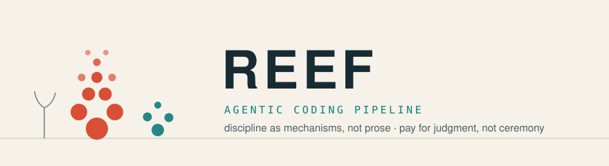

<picture>
  <source media="(prefers-color-scheme: dark)" srcset="assets/banner-dark.svg">
  
</picture>

<p align="center">
  
  
  
  
  
</p>

# Reef

> *A coral reef grows one calcified layer at a time; each organism leaves a hard structure the next builds on. Reef works the same way: every spec, task, ADR and journal line is a fossilized layer that outlives the session that wrote it.*

**Reef is a Claude Code plugin that runs a software project as a graph of gated work, and proves its own rules.**
A queue of rows becomes feature folders (a keyed `SPEC.md`, the decisions, vertical-slice tasks with real dependency
edges). Isolated implementers build the tasks in parallel in worktrees; a fresh context verifies each one; an
adversary hunts the loopholes; the loop merges into an integration branch; a human releases. The discipline lives in
**mechanisms** (scripts, a tokenizing PreToolUse guard, git hooks, a Stop hook), not in prompts, and every
mechanism ships with a test that shows it going red on the defect it exists to catch.

- **Governance as four questions, answered by code**: *authority* (who may decide), *evidence* (what proves it),
  *enforcement* (code on structured state, a tripwire on command text, or prose), *record* (where it is written).
- **Token-frugal by measurement**: the model is matched to the job by tier, the orchestrator reads one tick instead of
  the world, a session starts under 8k tokens of injected context, and every number in this README was measured on a
  real run (`docs/perf/`).
- **Honest about itself**: the enforcement ledger below says, row by row, what is code, what is a tripwire and what is
  only prose. When Reef ran on itself and hit its own worst bug, it restored the repository, refused to patch a
  protected file outside its plan, and stopped with a question for the human.

## Start here

| If you want | Go to |
|---|---|
| The page: how it works, what it needs, what it never does, what each stop means | **[mahmoudmoe.github.io/reef](https://mahmoudmoe.github.io/reef/)** |
| To install and run it on a project | [Quick start](#quick-start), then [How it works](#how-it-works) |
| To know what is code and what is only prose | [The honesty ledger](#what-is-enforced-and-how-the-honesty-ledger) |
| The numbers behind every claim | [Measured](#measured) and [`docs/perf/`](docs/perf/) |
| The design reasoning | [`docs/design/graph-and-setup.md`](docs/design/graph-and-setup.md) · [`docs/design/plan-cost.md`](docs/design/plan-cost.md) · [what the page shows, where and why](docs/design/site-information-architecture.md) |
| The Arabic manual | [`docs/manual/ar/index.html`](docs/manual/ar/index.html) · [on the site](https://mahmoudmoe.github.io/reef/manual/ar/) |

<details>
<summary><strong>Contents</strong></summary>

- [Quick start](#quick-start)
- [How it works](#how-it-works)
- [What is enforced, and how (the honesty ledger)](#what-is-enforced-and-how-the-honesty-ledger)
- [Who runs what (tiers and routing)](#who-runs-what-tiers-and-routing)
- [The adversarial stage](#the-adversarial-stage)
- [Settings](#settings-reefconfigjson--the-one-home-for-every-number)
- [Measured](#measured)
- [Layout](#layout)
- [Selftests](#selftests)
- [Status and what is next](#status-and-what-is-next)

</details>

## Quick start

```
/plugin marketplace add MahmoudMoe/reef
/plugin install reef@mahmoudmoe
```

| You have | Do | What happens |
|---|---|---|
| **A new project** | `/reef-init` | One batched question set: the branches and the **architecture grill** (host, shape, scale, store, auth boundary, one-year non-goals). Reef renders the one tree from templates adapted to your stack: `.reef/config.json` (every number, once), `AGENTS.md`, the constitution, the queue with batch 1 row 1 = **the walking skeleton**, `reef/architecture/architecture.md` (intent, C4 L1/L2) with draft ADRs for shape, host, store and auth, journal, glossary, day-zero, a release-only CI, Dependabot, the git hooks, every `scripts/reef-*`. |
| **An existing project** | `/reef-init`, then `/reef-assess` | **Nothing you wrote is overwritten**: a differing rendering lands in `.reef/proposed/<path>` with a diff (Reef's own untouched draft, per `.reef/init-manifest.json`, is just updated), and `python3 scripts/reef-init.py --accept <path>` applies the ones you choose. `/reef-assess` reads how the project works, was written and was pushed (every claim Observed with a proving path, or Inferred), scores how well a harness can hold it, and **recalibrates** its documents into the tree under ONE batched approval: archive, never delete, undo with one `git revert`. |
| **A feature to build** | `/reef-plan <row>` → `/reef-plan-review` → `/reef-task <slug>` → `/reef-review <slug>` | The grill, the spec and the tasks; the deterministic check and the semantic review; the task graph (every ready task at once, each in its worktree, verified by a fresh judge); the PR, the acceptance against `SPEC.md`, the diff review, the merge and the close. |
| **A queue of rows** | `/reef-loop` | The outer graph: every ready row through the four commands above, in parallel where rows do not collide, stopping only for the owner's decisions, a missing credential, a wrong spec, or a cap. |
| **A fresh clone** | `make setup` | Hooks are local git config and do not survive a clone. |

**Upgrading from 0.5:** re-run `/reef-init`. `scripts/reef-migrate` runs first and adds only keys, keeps `gates.test`
as the alias it is, writes `.reef/version`. Every check new in 0.6 **warns** on content planned under 0.5 and fails only
on content planned under 0.6. The flat `tasks/`/`docs/` layout keeps working; `python3 scripts/reef-migrate --layout`
moves it in one reviewed commit when you want the tree.

## How it works

```
reef/queue.md ──row──▶ /reef-plan ─────────▶ /reef-plan-review ───▶ /reef-task ─────────▶ /reef-review ──────────▶ gh pr merge ─────▶ close
 (outer graph: rows,    reef/features/<slug>/     deterministic checks    the TASK GRAPH: every     scripts/reef-converge      (merge.by: loop; the      row archived, draft
  Depends, batch,       SPEC.md (FR/SC keys),     + the semantic review   ready task at once, each  (Proof rows executed),     guard checks a GREEN      ADR numbered in ONE
  planned before found) adr/, tasks/; ONE human   (none for an all-light  in its worktree, on its   acceptance against         record bound to the       global sequence,
                        gate — the approval is a  plan); stamp over the   tier's models (guard-     SPEC.md, diff review,      forge head)               journal row with
                        RECORD bound to the       whole folder            enforced); judges are     one rollup, one cap;                                 per-AC status
                        plan's digest                                     read-only by the guard    scripts/reef-record                                      │
                                                                                                                                                             │
  python3 scripts/reef-loop.py tick = the one read of the world; the Stop hook refuses a turn that leaves ready work idle; ◀───────────────────────────────┘
  release PR branches.base → branches.release: gates.release (C4 drift, threat lint, secret scan, audit) run there once, the HUMAN merges; handoff rendered whole, /clear
```

1. **Plan.** `/reef-plan` grills, writes the feature folder (spec with layered `FR-n`/`SC-n` keys, one ADR with a
   diagram, tasks whose criteria cite those keys and whose proof is a test name or a command), and asks the one human
   question: `Approve plan <slug> at <digest16>?`. The approval is a **record** written by a hook from your own answer
   and bound to the plan's digest; an edit afterwards approves nothing.
2. **Review the plan.** A deterministic check (`reef-plan-check.py`, 14 to 19 checks) and, for anything heavier than
   `light`, a plan-reviewer agent. A `design` or `critical` task also gets the **loophole-hunter** on the plan before
   any code: *how can every check be green while the defect happens?*
3. **Build.** `/reef-task` computes the ready set from disk and dispatches every ready task at once, each in its own
   worktree on its tier's model. The guard refuses a dispatch outside the ready set, over the retry cap, on the wrong
   model, or without the approval. A **verifier** in a fresh context writes its pass/fail rule per criterion before
   reading the diff; the hunter runs again on a finished guard; a tree hash proves the judges touched nothing.
4. **Merge and close.** Acceptance against `SPEC.md`, a diff review, one rollup under one cap, a GREEN record bound to
   the forge head, the merge, then the close in the same breath: ADRs numbered in one global sequence, the row
   archived with the owner's words, the journal row written from measured state, the handoff rewritten whole.
5. **Resume anywhere.** State lives on disk. A new session reads the handoff head and the tick, about 300 tokens,
   and continues every row from its furthest completed step.

## What is enforced, and how (the honesty ledger)

Classes: **code** decides on structured state the agent cannot author · **tripwire** matches command text (a blocklist
over a shell surface is never complete; CI is the wall) · **prose** lives in a skill or agent file. Every `scripts/reef-*`
carries `# CLASS:` in its header and `tests/test_contracts.py` ties each row below to a script of that class.

| Rule | Enforced by | Layer |
|---|---|---|
| Retry cap / same-failure-twice | `reef-attempt` (data) + `reef-guard.py` deny at dispatch + `dispatches:` odometer | **code** |
| No implementer outside the READY SET — one graph across every feature folder (`blocked-by`, `resources:` slots, `graph.parallel`) | `scripts/reef-graph.py` computes it; the guard imports the plugin's own copy, takes one lock keyed on `paths.features`, denies, and on allow marks `in-progress` and writes `.reef/inflight/<id>` | **code** — launching every ready task is reef-task prose; the Stop hook catches the missing dispatch at turn end |
| The missing dispatch (loop active, ready work, nothing in flight, no wait, no stop reason) refuses the turn's end — once per tick state | `hooks.json` Stop → `reef-guard.py` → `scripts/reef-loop.py tick --assert-no-idle`; `stop_hook_active` honoured | **code** (at turn end) |
| Every role runs on its TIER's model (`tiers.<tier>.roles.<role>`, then `roles.*`); an all-light plan needs no plan-reviewer | `reef-attempt` prints `author:`/`verifier:`/`adversary:`; `reef-plan-check.py --needs-agent`; the guard resolves the tier from the `REEF-TASK:`/`REEF-FEATURE:` line on every dispatch and denies a mismatch | **code** |
| The plan reviewer's verdict is a record bound to the plan's digest; a feature with a task above `light` dispatches only on a `PASS` at the current digest | `scripts/reef-record plan-review`, `reef-plan-check.py --verify-stamp` (`review: MISSING \| STALE \| FAILED`), the guard at dispatch | **code** |
| Plan approval is the HUMAN's, bound to the plan's digest; an edit afterwards approves nothing | `/reef-plan` asks `Approve plan <slug> at <digest16>?`; the PostToolUse hook `scripts/reef-approval.py` writes `.reef/approvals/<slug>.json` only on `Approve` with the current digest; `reef-plan-check.py --verify-stamp` and the guard require it (0.6-planned features; older ones warn) | **code** (the result shape is schema-verified: headless sessions exclude AskUserQuestion, see `docs/perf/payloads-2026-10-16.md`) |
| Nobody writes an approval or a review record by hand | `reef-guard.py` denies Bash writes and Edit/Write/MultiEdit under `.reef/approvals/`, `.reef/review/` | **tripwire** |
| Review verdicts are RECORDS bound to the forge head; `gh pr merge` only against a GREEN record (clean base merge or claims-only commits are the only carry-overs; rebase, code push, slow or failed gh deny) — `merge.by: loop` only | `scripts/reef-record` (`gh pr view`, `gh api …/git/commits`); `reef-guard.py` on `gh pr merge` / `gh api …/merge` under its own gh deadline | **code** (presence) |
| Judges are read-only: verifier, loophole-hunter, plan-reviewer, Explore get no mutating git, no Bash write, no CI wait; a typeless sub-agent is locked while `.reef/verifying/<id>` exists; no sub-agent waits on CI or sleeps a minute | `reef-guard.py` reads `agent_type`/`agent_id` from the payload (verified live, 0.0); the snapshot hash is the backstop | **code** + **tripwire** (the write detection is a token match) |
| A hung guard denies; no python3 denies a dispatch | `signal.alarm` deadline inside the guard; `timeout` + `onFailure: block` on every PreToolUse matcher (`scripts/reef-guard-profile.py` sets them at ≥ 5 × p95) | **code** |
| The guard's own files and the `roles\|caps\|gates\|tiers` keys change only under a `critical` task in flight or inside Reef's own repository | `reef-guard.py` Edit/Write/MultiEdit matcher (JSON diff of the protected keys) and Bash write detection; `reef-init --accept` stays allowed | **code** for the keys, **tripwire** for the Bash shapes |
| Plan edited after approval → re-review; the stamp covers the WHOLE feature folder (spec, child specs, ADRs, tasks) | `reef-plan-check.py --verify-stamp`, per feature, re-checked by the guard at every dispatch against the task file's own worktree | **code** |
| A feature folder is well-formed: a descriptive slug, `SPEC.md` with `Row:` and layered `FR-n` keys, child specs with `Parent:`, ACs citing keys of their own folder, ≤ `plan.max_tasks` tasks, nothing else inside | `reef-plan-check.py` (`--rules` prints every rule with the project's numbers); `reef-queue.py check` (structure, slug); `reef-structure --check` | **code** |
| Criterion and proof split (new shape): one declarative sentence ≤ `writing.criterion_words`, its proof in the `## Proof` row; old shape stays valid; sentences ≤ `writing.sentence_words` | `reef-plan-check.py` (fails under 0.6, warns older); the claimed-twice check reads Proof rows | **code** |
| Every Proof row holds on the branch before acceptance (`missing` / `contradicts` under the one cap) | `scripts/reef-converge <feature>` | **code** when run (reef-review prose) |
| A tier only gets heavier: path classes (`tiers.design.paths`, `tiers.critical.paths`) and `touches:` (pii/money/auth → critical, migration → design + `Rollback:`) | `scripts/reef-tier.py` from the diff; `reef-plan-check.py` on the declaration; `reef-init` lists older tasks the rails would move | **code** when run |
| Adversarial pass on the PLAN before code and on the finished GUARD before close (`design` and `critical`) | `scripts/reef-adversarial` records a PASS bound to the plan's content (`BLOCKER: none` is no blocker; a bold one is); the guard refuses a dispatch without it; the pre-commit refuses a design/critical task entering `done/` without `adversarial-guard:` | **code** |
| A critical `touches: auth\|pii\|money` task needs a threat model at least as new as the architecture | `reef-plan-check.py`; `scripts/reef-threat.py lint\|fresh` (every boundary crossing has a mitigated or accepted STRIDE row) | **code** |
| The architecture model is generated from code with a proof per element; drift is element-level, once per release | `scripts/reef-c4.py generate\|lint\|--diff` as `gates.release.c4`; `reef-ci-local.sh --release` | **code** |
| Hand-backs ≤ `writing.handback_words` with a claims list; verifier reports carry `RUN:`, one `RULE AC<n>` per criterion citing its Proof row, evidence per AC; hunter reports carry `DEFECT`, cited `BLOCKER`s, `VERDICT`; every report ≤ `writing.report_words`; a fix round's claims point inside its own diff; after GREEN only claims-only commits | `scripts/reef-claims.py check --handback` / `report` / `check <range>` / `claims-only` | **code** when run (reef-task prose) |
| One cap per item after GREEN (acceptance + diff + CI share it); one rollup per feature | `reef-attempt` and the guard refuse a second rollup | **code** |
| Draft ADRs in parallel branches, numbered at merge in ONE global sequence across `reef/architecture/adr/` and every feature `adr/`; path citations stay files | `reef-queue.py adr-number`; `reef-plan-check.py` exempts `draft-*.md` | **code** |
| The tick never advertises a task whose plan lacks the human's approval at the current digest or a fresh review stamp: it is `awaiting: <feature> (approval \| re-approval \| plan review)` | `scripts/reef-loop.py tick` runs `reef-plan-check.py --verify-stamp --feature` per ready feature | **code** |
| Queue status has one home (the task files, a folder's `SPEC.md Row:` links slug to row); `reef/features/README.md` is generated | `reef-queue.py status\|ready\|check\|index` | **code** |
| Context ceiling: a dispatch over `caps.context_tokens` is denied and the guard itself renders `HANDOFF.md` from measured state first ("/clear now"); from `caps.context_warn` the hook warns the model | `reef-guard.py` on Task/Agent via `scripts/reef-cost.py --live` on the payload's `transcript_path` (tail only), then `scripts/reef-handoff --write` | **code** (defaults set from the measured rows; 0 = off on a migrated project) |
| What happened while nobody was in the room: the tick, tasks by status and attempts, journal rows since a date, found rows, stops, sessions with per-feature growth, rejected judge reports — one screen, no model | `scripts/reef-watch [--since] [--json]` | **code** (a report, not a gate) |
| `/reef-assess` writes data, not an essay: the observed sections present, every claim `Observed — path:line` or `Inferred`, the harnessability table's five dimensions summing to its heading | `scripts/reef-claims.py assess` (fixture: the real ledger report) | **code** |
| The queue has one home — `paths.queue` on `branches.base` in the main checkout; a feature branch whose queue differs from its fork point fails the plan check | `reef-plan-check.py` queue-home check; `tests/test_feature_spec.py::QueueHasOneHome` | **code** |
| No-progress parking (`loop.no_progress_ticks` identical ticks, nothing in flight) and token budgets (`caps.feature_tokens`, `caps.batch_tokens`) | `scripts/reef-loop.py tick` | **code** |
| Reports, never raw material: the exit code plus the failing block (`context.failure_lines`), the whole log on disk | `reef-gate.sh --failures`, `reef-ci-local.sh` (truncation inside the gate keeps the exit code) | **code** |
| Session start under `writing.session_start_tokens`: the handoff head + the tick + the next command, nothing else read | `hooks.json` SessionStart → `reef-loop.py tick --session-start --hook`; `AGENTS.md` ≤ 80 lines and the skills' re-entry sections (contracts) | **code** for the cap, **prose** for what the model then reads |
| Commit gate tests the index, outside git's hook environment (`GIT_DIR`, `GIT_INDEX_FILE`, `GIT_WORK_TREE`, `GIT_PREFIX`, `GIT_CONFIG_PARAMETERS` unset, so a suite's own git fixtures never touch the real repository) | `.githooks/pre-commit` (+ `pre-merge-commit`) | **code** |
| Local CI = CI, every exit code read; a skip is exit 2, not success; `gates.release` run on release-branch PRs only | `scripts/reef-ci-local.sh [--ci] [--release]` | **code** |
| Repository protection (release branch protected, push protection, CODEOWNERS), idempotent | `scripts/reef-repo` | **code** when run |
| Documents live in the layout; recalibration archives, never deletes, in one revertable commit with links rewritten | `scripts/reef-recalibrate plan\|--apply\|history`; `scripts/reef-structure --check` (both layouts) | **code** |
| Migrations are versioned and idempotent; a gap refuses | `scripts/reef-migrate` + `migrations/<from>-to-<to>.py` | **code** |
| `git stash`; a gate piped into `tail`/`grep`; bypass spellings (`--no-verify`, `-n`, hooksPath, env smuggling, `rm .githooks`) | `reef-guard.py` (tokenizing) | **tripwire** — CI is the wall |
| Push gate | none by design — a worktree gate at push time only false-rejects | **CI is the wall** |
| Verifier didn't touch the tree | `reef-snapshot.sh` before/after (nested worktrees excluded) | code hash, **prose trigger** |
| Verifier writes its pass/fail rule per AC before reading the diff; attacks the last round's fix first; the four kinds that fail (regression, bypass, correctness, failed AC — all else NIT); browser evidence or `Not verified in a browser:`; "cannot verify here" needs the probe; the hunter lets the Scope draw the BLOCKER/NEW-ROW line | reef-verify / verifier / loophole-hunter text, under the eval (`scripts/reef-eval`) | **prose** (measured: `docs/perf/eval-baseline-2026-10-16.md`) |
| Explore agents label every claim Observed (with a proving path) or Inferred | reef-explore / reef-assess text; the lock above is the mechanism | **prose** |
| `/reef-init` never overwrites, idempotent, one home per fact, release-only CI | `scripts/reef-init.py` (`test_init.py`) | **code** |

## Who runs what (tiers and routing)

Four tiers, each a model per role and an effort, resolved at dispatch by `scripts/reef-attempt` and refused by the
guard on mismatch — `tiers.<tier>` in `.reef/config.json`, every key overridable; an unset table is exactly the 0.5
`roles.*` behaviour.

| Tier | Meaning | planner / plan_reviewer / adversary / verifier / reviewer / security | author | effort | verify |
|---|---|---|---|---|---|
| `critical` | first-time analysis, architecture, constitution, threat model, `touches: money\|pii\|auth`, the guard paths | opus | opus (set a heavier model per project) | high | judge; adversary on plan and on guard |
| `design` | two people would build it differently; a mechanism that failed twice | opus / opus / opus / opus / opus / opus | opus | high | judge; adversary twice |
| `full` | the default | opus / opus / opus / opus / opus / opus | opus | medium | judge |
| `light` | allowlisted paths, no risk path, under the line ceiling | plan_reviewer **none** (the deterministic check alone stamps) | opus (**sonnet not shipped**: unproven by the eval) | low | gate + golden test, no judge |

Agent files carry a DEFAULT model equal to the role's default; the dispatch-time model always overrides it. Effort
travels in the dispatch prompt. Every role dispatch starts with the `REEF-TASK:` (or `REEF-FEATURE:`) line, so the
guard knows the tier; `Explore` runs as `mechanic`.

## The adversarial stage

A `design` or `critical` task runs the `loophole-hunter` twice — on the plan before code, on the finished guard before
close — with one question: *how can every check be green while the defect happens?*; once per release it runs
`pass=system` against the threat model and a running worktree. Read-only by the guard, cites file:line, ranks holes by
whether they will happen here and by their real cost, attacks the last round's fix first, and lets the task's Scope
draw the line between a BLOCKER and a NEW-ROW. BLOCKER fails the pass under the cap; NEW-ROW becomes a queue row.
`scripts/reef-adversarial` records only a PASS without a blocker. Never on `mech`.

Measured on Reef's own code (the 0.7 dogfood): the hunter rejected the plan of a 60-line task six times, each time on
a real defect found by probing the transcripts on disk, and accepted the seventh; on the finished code it passed with
seven NEW-ROWs. Its eval: catch-rate 1.00, precision 1.00, false-FAIL 0.17 at k=3 over the whole corpus.

## Settings (`.reef/config.json` — the one home for every number)

| Key | Default | Effect |
|---|---|---|
| `gates.fast` / `gates.full` / `gates.extra` / **`gates.release`** | `""` / stack test / `{}` / c4 drift + gitleaks + the stack's audit (new project; proposed on upgrade) | commit gate / verify, review, CI / other gates / release-branch gates (`reef-ci-local.sh --release`; a missing tool is exit 77 = skipped = exit 2) |
| `caps.attempts` | `3` | fix rounds per task, and per item on its rollup |
| **`caps.dispatch_reserve`** | `30000` (new project); `0` (off) | room that must be left under `caps.context_tokens` for an **implementer** dispatch (a new task starting): under it the guard checkpoints (HANDOFF.md) and denies with "/clear NOW"; judges and mechanics stay allowed to the ceiling and finish the task in hand. First contact: a task started at 126k of 150k was split across two sessions. |
| **`caps.context_tokens` / `caps.context_warn`** | `150000` / `100000` (new project); `0` / `0` (off) on a migrated 0.5 project | the dispatching session's context ceiling / warning. Set from the measured rows (`docs/perf/dogfood-2026-10-16.md` §E): session maxima 58k–159k, p90 148k, so the warning fires late in a planning or critical-row session and the ceiling only on a runaway; a 60%-of-window ceiling would have cut the critical row in two. Tighten per project if its rows are smaller |
| **`caps.feature_tokens` / `caps.batch_tokens`** | `0` / `0` (off) | token budgets the tick checks; over one, the feature or batch parks |
| **`tiers.<tier>.roles` / `.effort` / `.paths`** | the table above; design paths auth/crypto/secrets/migrations; critical paths `.githooks/**`, `scripts/reef-*`, `hooks/**`, `.reef/config.json` | model per role, effort, path classes that force the tier |
| `tiers.light.allow` / `max_lines` / `migrations` | `docs/**, README.md` / `80` / migration dirs | what may be light |
| `graph.parallel` · `resources.<name>.slots` · `worktree.dir` / `worktree.setup` | `10` · `1` (`heavy` 2) · `.reef/worktrees` / stack install | as in 0.5 |
| `roles.*` | author opus · verifier opus · plan_reviewer opus · planner opus · adversary opus · reviewer opus · security opus · mechanic sonnet | the fallback when the tier table does not name the role |
| `merge.by` · `ci.feature_gate` · `branches.base` / `branches.release` | `human` · `ci` · `main` / `main` (init: `develop` / `main`) | as in 0.5; `ci.check_name` (`every gate, once`) names the required check for `reef-repo` |
| **`paths.features`** · `paths.tasks` / `adr` / `glossary` / `runlog` / `queue` | `reef/features` (0.6 tree) · 0.5 locations for a 0.5 project, `reef/…` for a 0.6 one | where things live; the loaders accept either shape |
| `plan.test_re` / `plan.max_words` / **`plan.max_tasks`** | `""` / `0` / `12` | test-name override / task word cap / split a feature above this |
| `writing.task_words.<tier>` · `handback_words` · `prompt_words` · **`report_words`** · `journal_words` / `queue_words` · **`sentence_words`** / **`criterion_words`** · **`session_start_tokens`** | 600/2500/2500/2500 · 150 · 120 · 900 (measured: real reports run 540–710 words for 6–7 criteria) · 40 000 / 35 000 · 25 / 50 · 8 000 | caps; `task_words`, the sentence and criterion rules fail only under 0.6 |
| **`loop.inflight_stale_minutes` / `loop.no_progress_ticks`** | `90` / `3` | an in-flight marker older than this is "returned"; identical ticks before the loop parks |
| **`context.failure_lines` / `context.read_lines_max` / `context.explore_files`** | `60` / `300` / `40` | the failing block's cap; (the Read tripwire was cut — the key is reserved); an Explore agent's file budget |
| **`converge.test_cmd`** | `""` | how `reef-converge` runs one named test (`{name}`); empty = the full gate once |

0.5 configs keep working: `gates.test` is an alias of `gates.full`; every new key defaults to the old behaviour;
`scripts/reef-migrate` adds the keys once.

## Measured

Every claim above has a number behind it, and the numbers live in `docs/perf/`:

- **`dogfood-2026-10-16.md`** — Reef run end to end, headless, on a fresh Python project (six stages: init 11k, plan
  66k, plan review 25k, task graph 63k, review 54k, close 39k of orchestrator context growth; the CLI it built works) and
  on a clone of itself (one critical-tier row, 111k). Seven defects in Reef found by the run, each fixed with a test
  shown red first. `scripts/reef-cost.py` reports per-feature growth (`rows`), a feature Reef built on itself.
- **`baseline-2026-10-16.md`** — the 0.5 session the 0.6 targets were set against: first turn 91k tokens, 43% of
  context attachments, 31% raw Bash output.
- **`eval-baseline-2026-10-16.md`** — `scripts/reef-eval` on the frozen corpus, k=3: every true blocker caught by every
  agent; the verifier's false-FAIL 0.33 → 0.00 (0.6), the hunter's 0.33 → 0.17 (0.7), nothing dropped; the corpus's own
  PASS fixtures were wrong three times and the agents were right each time.
- **`payloads-2026-10-16.md`** — the hook payloads Reef relies on, captured from live Claude Code sessions, with what
  was and was not verified.
- **`guard-profile-2026-10-16.md`** — p95 per hook matcher (≤ 130 ms); every hook timeout ≥ 5 × p95.
- **`docs/design/plan-cost.md`** — where a planning session's tokens go and the cuts (a fifth went to reading the
  checker's source; `reef-plan-check.py --rules` replaces that read).

## Layout

One tree, grouped by feature; machine state in `.reef/`; three files at the root; tooling where git and CI expect it.
```
AGENTS.md  CLAUDE.md (pointer)  HANDOFF.md                 # root: the three files every agent meets first
.reef/                                                      # config and machine state
  config.json  version                                      #   committed
  loop.json  inflight/  verifying/  review/  approvals/  worktrees/  proposed/  ci-local/  .plan-review.json   # gitignored
reef/                                                       # every committed Reef artifact
  constitution.md  queue.md  queue-archive.md  journal.md  glossary.md  day-zero.md  recalibration.md
  architecture/   architecture.md  conventions.md  workspace.dsl  context.md  container.md  threat-model.md
                  adr/NNNN-<slug>.md                        # project-wide decisions only (stack, hosting, boundaries)
  features/       README.md                                 # generated index of features (never hand-edited)
    <feature-slug>/                                         # one folder per queue row, named by the feature
      SPEC.md                                               #   the intent, end to end, FR keys by layer
      specs/<part>.md                                       #   child specs, big features only
      adr/NNNN-<slug>.md                                    #   this feature's decisions, with diagram
      tasks/NNNnn-<slug>.md   tasks/done/                   #   the plan; ids global; rollup lives here too
  archive/<date>/
scripts/reef-*   .githooks/   .github/workflows/ci.yml      # tooling where git and CI expect it
```

The plugin itself: `skills/` (init, assess, explore, loop, plan, plan-review, task, verify, review, c4, threat) ·
`commands/` · `agents/` (implementer, verifier, plan-reviewer, loophole-hunter, mechanic) · `scripts/` (`reef-init.py`,
`reef-migrate`, `reef-loop.py` [tick|start|stop|wait], `reef-handoff`, `reef-gate.sh` [fast|full|--failures],
`reef-attempt`, `reef-guard.py`, `reef-approval.py`, `reef-record`, `reef-graph.py`, `reef-plan-check.py`
[--rules|--digest|--needs-agent|--verify-stamp], `reef-converge`, `reef-adversarial`, `reef-claims.py`
[check|--handback|report|claims-only], `reef-tier.py`, `reef-queue.py` [status|ready|check|adr-number|index|footnote|add-row|set-depends],
`reef-structure`, `reef-recalibrate`, `reef-repo`, `reef-c4.py`, `reef-threat.py`, `reef-ci-local.sh` [--ci|--release],
`reef-snapshot.sh`, `reef-cost.py`, `reef-watch`, `reef-eval`, `reef-guard-profile.py`) · `hooks/hooks.json` (PreToolUse Bash ·
Task|Agent · Edit|Write|MultiEdit; PostToolUse AskUserQuestion; Stop; SessionStart) · `migrations/` ·
`schemas/task.schema.json` · `templates/` (config, task, spec, adr, glossary, runlog, pre-commit, stacks/, project/) ·
`tests/eval/` (the corpus) · `tests/fixtures/payloads/` · `docs/perf/`

## Selftests

`sh tests/run.sh` — 449 sabotage and contract tests (360 Python + 89 shell, as the suite runs them). Every mechanism in
this plugin has a test here that shows it going RED on the defect it exists to catch (each suite is listed in
`tests/run.sh`); CI runs them on ubuntu (dash — the honest POSIX check) and macos, and a change to a `CLASS: code`
script without a `tests/` change fails the PR. The live eval (`scripts/reef-eval run`) needs the CLI and credentials
and never runs in CI; its fixture replay does.

## Status and what is next

Reef 0.6.0 is released and has been run end to end on a fresh project and on itself (`docs/perf/dogfood-2026-10-16.md`).
It is usable today for a project whose owner accepts three facts: the human gates are a plan approval and the release
merge, nothing in between; a row costs real tokens (a two-task row ran about $16 at API list prices across five sessions,
on a subscription that is plan usage, not an invoice); and a `gh`-authenticated forge is needed for the review, record
and merge steps (without one, Reef stops with USER ACTION REQUIRED and says exactly what it would have run).

Open for 0.7, in `CHANGELOG.md` under "0.7 (unreleased)" and the dogfood report: a live capture of the AskUserQuestion payload (needs an interactive
session), a sonnet author for the `light` tier once an author eval exists, recalibrating a project that already runs Reef, and
the found rows the Reef-on-itself run filed. Done this cycle: the planning cut (`docs/design/plan-cost.md`), `/reef-assess` as data,
the guard's own checkpoint at the ceiling, `reef-watch`.

MIT licensed. Built with Claude Code.
