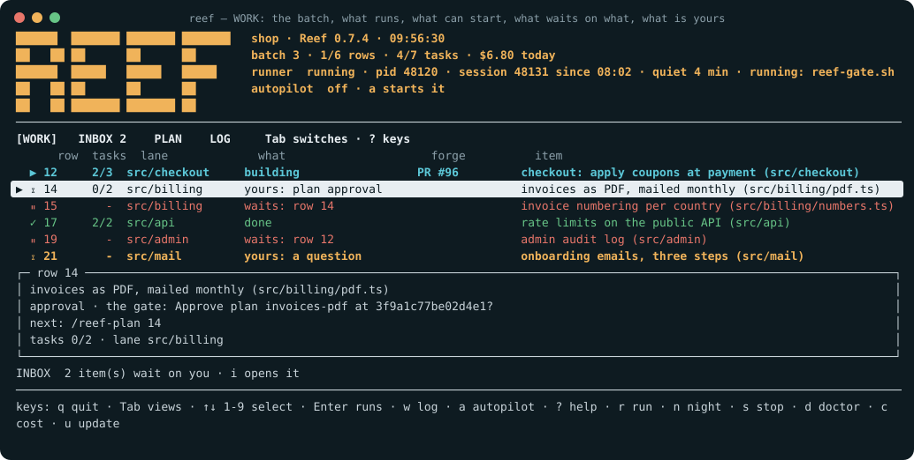
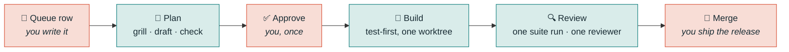

<p align="center">
  
</p>

<p align="center">
  <a href="https://mahmoudmoe.github.io/reef/"></a>
  
  
  
  <a href="https://github.com/MahmoudMoe/reef/actions/workflows/ci.yml"></a>
</p>

<h1 align="center">Reef 🪸</h1>

<h3 align="center">You write the work. Reef does it. You decide twice.</h3>

<p align="center">
  A Claude Code plugin that turns your backlog into merged, tested pull requests —<br>
  while you approve the plan and ship the release.
</p>

<p align="center">
  <a href="#-quick-start"><b>Quick start</b></a> ·
  <a href="#-how-it-works"><b>How it works</b></a> ·
  <a href="https://mahmoudmoe.github.io/reef/"><b>Website</b></a> ·
  <a href="https://mahmoudmoe.github.io/reef/manual/ar/"><b>الدليل العربي</b></a> ·
  <a href="docs/reference.md"><b>Full reference</b></a>
</p>

<br>

<p align="center"></p>

## ✨ Why Reef

<table>
<tr>
<td width="50%" valign="top">

**📝 One line in, one PR out**<br>
Write a row in the queue. Reef plans it with you, builds it test-first, reviews it and merges it.

</td>
<td width="50%" valign="top">

**🧑‍⚖️ You decide twice**<br>
Approve the plan. Merge the release. Everything in between is checked by code, not by trust.

</td>
</tr>
<tr>
<td valign="top">

**🛡️ Guarded, not prompted**<br>
A guard runs before every command. Agents can't fake an approval, skip a test or merge red.

</td>
<td valign="top">

**🌙 Hand it the day — or the night**<br>
`reef autopilot` keeps working for hours. Your proxy decides only what you allowed. You read the report.

</td>
</tr>
</table>

## 🚀 Quick start

**1. Install** — in Claude Code:

```
/plugin marketplace add MahmoudMoe/reef
/plugin install reef@mahmoudmoe
```

**2. Set up your project** — new or existing, nothing you wrote is overwritten:

```
/reef-init
```

**3. Run it** — pick your style:

| | Type | What happens |
|---|---|---|
| 🖥️ **The screen** | `reef` | See every row, every wait, and the one key that answers it. |
| 🔁 **The loop** | `/reef-loop` | Reef works the queue in your session and asks you at each gate. |
| ✈️ **Autopilot** | `reef autopilot` | Runs on its own until the batch is done. You come back to merges. |
| 🌙 **A night** | `/reef-night` | Approve tonight's plan once, then sleep. Morning report waits for you. |

> **macOS or Linux. On Windows, run Claude Code inside WSL2.** You also need `python3`, `git` and `gh` (logged in).

## 🧭 How it works



1. **Plan** — Reef asks only what your spec leaves open, then drafts small tasks, each proved by a named test.
2. **Approve** — one question: `Approve plan <slug> at <digest16>?` Your yes is tied to that exact plan.
3. **Build** — each task test-first in its own worktree, with a fast gate on every task.
4. **Review** — the full suite runs once, then one fresh reviewer checks the feature against its spec.
5. **Merge** — green evidence only. Features merge themselves; **the release is always yours.**

Risky work (auth, money, personal data, migrations) takes the **critical path**: an adversary attacks the plan and the code before anything merges.

## 🔒 Built to keep you in control

- 📄 **Setup won't overwrite your files** — `/reef-init` proposes a change; you choose whether to accept it.
- 🗄️ **Clean-up archives instead of deleting** — old documents move to an archive in one commit, and one `git revert` brings them back.
- 👀 **Reviewers are read-only by design** — the guard blocks their writes, and a tree hash checks nothing changed.
- 🚢 **The release merge is yours** — Reef merges features on green; shipping the release waits for you.

<sub>Reef is provided as is, under the MIT license. Keep your work committed and backed up.</sub>

## 📚 Learn more

| Want to… | Go to |
|---|---|
| See every command and mode | [Reference → Install](docs/reference.md#install) |
| Understand a message Reef showed you | [Reference → When it stops](docs/reference.md#when-it-stops) |
| Change a cap, model or branch | [Reference → Settings](docs/reference.md#settings-reefconfigjson) |
| Run on OpenCode | [Reference → Hosts](docs/reference.md#hosts) |
| See what's enforced by code vs. prose | [Reference → For maintainers](docs/reference.md#for-maintainers) |
| Contribute | [CONTRIBUTING.md](CONTRIBUTING.md) · [CHANGELOG.md](CHANGELOG.md) |

<br>

> *A coral reef grows one layer at a time; each leaves a hard structure the next builds on.*
> *Every spec, task and decision in Reef is a layer that outlives the session that wrote it.*

<p align="center"><sub>MIT licensed · Built with Claude Code</sub></p>
