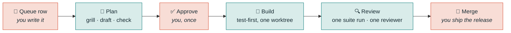

<p align="center">
  
</p>

<p align="center">
  <a href="https://mahmoudmoe.github.io/reef/"></a>
  
  
  
  <a href="https://github.com/MahmoudMoe/reef/actions/workflows/ci.yml"></a>
</p>

<h1 align="center">Reef 🪸</h1>

<h3 align="center">You write the work. Reef does it. You decide twice.</h3>

<p align="center">
  A Claude Code plugin that turns your backlog into merged, tested pull requests —<br>
  while you approve the plan and ship the release.
</p>

<p align="center">
  <a href="#-quick-start"><b>Quick start</b></a> ·
  <a href="#-how-it-works"><b>How it works</b></a> ·
  <a href="#-the-reef-command"><b>The <code>reef</code> command</b></a> ·
  <a href="https://mahmoudmoe.github.io/reef/"><b>Website</b></a> ·
  <a href="https://mahmoudmoe.github.io/reef/manual/ar/"><b>الدليل العربي</b></a> ·
  <a href="docs/reference.md"><b>Full reference</b></a>
</p>

<br>

<p align="center"></p>

## ✨ Why Reef

<table>
<tr>
<td width="50%" valign="top">

**📝 One line in, one PR out**<br>
Write a row in the queue. Reef plans it with you, builds it test-first, reviews it and merges it.

</td>
<td width="50%" valign="top">

**🧑‍⚖️ You decide twice**<br>
Approve the plan. Merge the release. Everything in between is checked by code, not by trust.

</td>
</tr>
<tr>
<td valign="top">

**🛡️ Guarded, not prompted**<br>
A guard runs before every command. Agents can't fake an approval, skip a test or merge red.

</td>
<td valign="top">

**🌙 Hand it the day — or the night**<br>
`reef autopilot` keeps working for hours. Your proxy decides only what you allowed. You read the report.

</td>
</tr>
</table>

## 🚀 Quick start

**1. Install** — in Claude Code:

```
/plugin marketplace add MahmoudMoe/reef
/plugin install reef@mahmoudmoe
/reload-plugins
```

Or from a terminal: `claude plugin marketplace add MahmoudMoe/reef`, then `claude plugin install reef@mahmoudmoe`.

**2. Set up your project** — new or existing, nothing you wrote is overwritten:

```
/reef-init
```

It asks one batched set of questions (your branches, the architecture grill), writes `.reef/config.json`, `AGENTS.md`, the queue and the git hooks, and copies Reef's scripts into `scripts/` — `scripts/reef` among them, the one entry point below. Run it again after a plugin update; it proposes, never overwrites.

**3. Run it** — pick your style:

| | Type | What happens |
|---|---|---|
| 🖥️ **The screen** | `reef` | See every row, every wait, and the one key that answers it. |
| 🔁 **The loop** | `/reef-loop` | Reef works the queue in your session and asks you at each gate. |
| ✈️ **Autopilot** | `reef autopilot` | Runs on its own until the batch is done. You come back to merges. |
| 🌙 **A night** | `/reef-night` | Approve tonight's plan once, then sleep. Morning report waits for you. |

> **macOS or Linux. On Windows, run Claude Code inside WSL2.** You also need `python3`, `git` and `gh` (logged in).

## 🖥️ The `reef` command

`reef` (the script `scripts/reef` in your project) is the one entry point from a terminal. Alone it opens the screen; with a verb it runs the script behind it. Every key on the screen runs a command you could type.

| Command | What it does |
|---|---|
| `reef` | The screen: WORK (every row, its state, tasks, lane and PR), INBOX (every wait with the command that answers it), PLAN, LOG. `a` opens the autopilot panel, `u` applies a new Reef, `?` lists the keys. |
| `reef status` | Where things stand: the runner, the night, the last session, the loop's wait. Exits 2 while a wait is yours. |
| `reef doctor` | What is wrong and the one command that fixes each thing — the plugin, the probe, the scripts behind the plugin, the queue's home, worktrees. |
| `reef update` | A new Reef: pulls the plugin, refreshes your project's copies in one commit and pushes it, re-proves the worktree setup, refreshes the marketplace. It names scripts Reef no longer ships, and never deletes them. |
| `reef autopilot` | The runner on its own under `reef/proxy.md`, the contract you approved once. Mahmoud decides inside it; anything else is filed as your question and the runner sleeps until you answer. `reef autopilot off` stops it. |
| `reef approve <row>` · `reef answer <row> "<text>"` | The two things you type most: a row's plan approval at its current digest, and your answer to a filed question. |
| `reef resume` · `reef stop` · `reef watch` | Restart a runner after you decided; end it after its current session; follow its live steps. |

`reef --help` lists every verb; `reef --all` lists every script with its purpose.

## 🧭 How it works



1. **Plan** — Reef asks only what your spec leaves open, then a planner drafts small vertical-slice tasks, each criterion proved by a named test. A deterministic check (`reef-plan-check.py`) must be green before you see it.
2. **Approve** — one question: `Approve plan <slug> at <digest16>?` Your yes is tied to that exact plan.
3. **Build** — one worktree per row, its tasks in order, each test-first, with the fast gate on every task.
4. **Review** — the full suite runs once, on the head that merges. Then **one** fresh, read-only reviewer (`reef:acceptance`) judges the feature against its spec, the diff against the base, and every criterion against its named test in that one result.
5. **Merge** — on green evidence of the merged commit only. Features merge themselves; **the release is always yours**, after a security pass on the whole batch.

**Risk decides the path.** The tier of each task is computed from the paths it touches, and it only goes up.

| Path | When | What runs |
|---|---|---|
| **Fast path** | Every task is `light` or `full`, and none touches auth, personal data, money or a migration. | The plan check is the plan's review. No per-task verifier: the suite and the one reviewer prove the row. Builds on sonnet; the planner stays on opus. |
| **Critical path** | Any task is `design` or `critical`, or touches auth, pii, money or a migration. | The same steps, plus the loophole-hunter on the plan before code, a fresh verifier per task, and in the one review a `## Guard pass` (and a `## Security` section on a risk touch). The `design` and `critical` tiers run every role on opus. |

## 🧑‍💼 Mahmoud, your proxy

`reef:mahmoud` is the agent that stands in for you when you hand Reef the day (`reef autopilot`) or a night (`/reef-night`). He is the project's CTO: he decides what you would decide, from your profile (`reef/owner.md`) and your own footnotes, **only inside the contract you approved** — the kinds its `Decides:` line names (plan approvals, questions, holes after the hunter's rounds, found-row triage, process and wording). He challenges a plan once, on the record, and chooses the simplest robust thing. Every decision is recorded in his name with its undo. A hard limit — the release, secrets, money, deletion, Reef's own config — or a kind the contract does not name stays yours.

## 🔒 Built to keep you in control

- 📄 **Setup won't overwrite your files** — `/reef-init` proposes a change; you choose whether to accept it.
- 🗄️ **Clean-up archives instead of deleting** — old documents move to an archive in one commit, and one `git revert` brings them back.
- 👀 **Reviewers are read-only by design** — the guard blocks their writes, and a tree hash checks nothing changed.
- 🛡️ **The guard protects your project's files, not your machine** — it judges a write by where it lands: inside a Reef project its rules hold whatever the session's folder is; outside every project it stays out of the way.
- 🧾 **Found work waits for you** — an agent files a found row only with evidence of a real defect, and it is built only after you promote it (`reef-queue.py promote <id> --reason "…"`).
- 🚢 **The release merge is yours** — Reef merges features on green; shipping the release waits for you.

<sub>Reef is provided as is, under the MIT license. Keep your work committed and backed up.</sub>

## 📍 Status

**0.7.4** is the released version (2026-11-04). `main` is the **0.7.5** development line (`0.7.5-dev.N`): one review per row on every path (the plan-reviewer, converge and the separate per-feature hunter and security dispatches are gone), opus for the planner and the critical path and sonnet for the rest, found rows built only once you promote them, a guard scoped to Reef projects, a close that recovers from a cut-off session, and the `reef-structure --quality` clean-code gate (opt-in). Every change is in [CHANGELOG.md](CHANGELOG.md) under "0.7.5 (unreleased)".

## 📚 Learn more

| Want to… | Go to |
|---|---|
| See every command and mode | [Reference → Install](docs/reference.md#install) |
| Understand a message Reef showed you | [Reference → When it stops](docs/reference.md#when-it-stops) |
| Change a cap, model or branch | [Reference → Settings](docs/reference.md#settings-reefconfigjson) |
| Run on OpenCode | [Reference → Hosts](docs/reference.md#hosts) |
| See what's enforced by code vs. prose | [Reference → For maintainers](docs/reference.md#for-maintainers) |
| Contribute | [CONTRIBUTING.md](CONTRIBUTING.md) · [CHANGELOG.md](CHANGELOG.md) |

<br>

> *A coral reef grows one layer at a time; each leaves a hard structure the next builds on.*
> *Every spec, task and decision in Reef is a layer that outlives the session that wrote it.*

<p align="center"><sub>MIT licensed · Built with Claude Code</sub></p>
