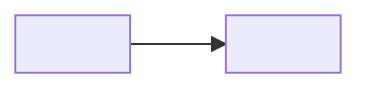

# ADR NNNN — <title>

Status: Proposed | Accepted | Superseded by NNNN

## Context
<the forces: what problem, what constraints, why now — 3 lines max>

## Decision
<what we chose, stated as fact>

## Consequences
+ <what gets easier>
- <what gets harder — every decision has a cost; "none" is a lie>

## Diagram

<a feature ADR draws the change; a project-wide ADR under reef/architecture/adr/ may draw the boundary it moves>
