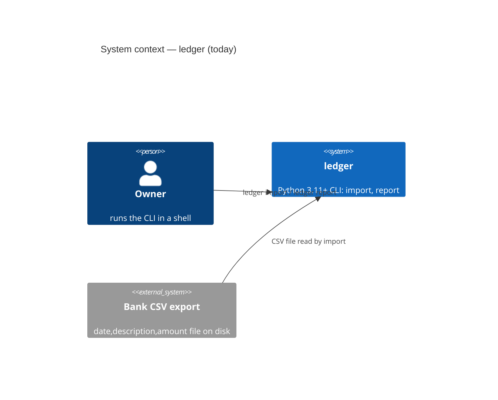
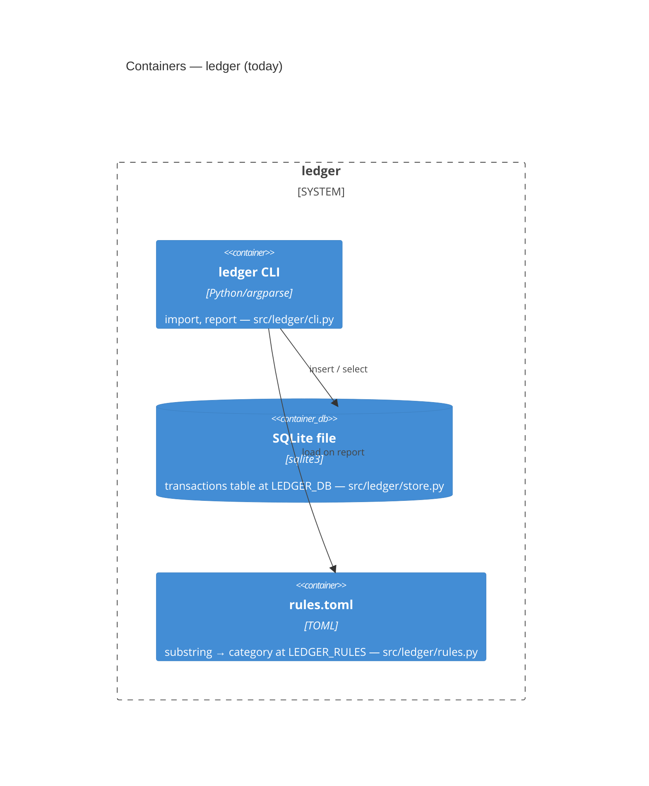

# Architecture — ledger

Rewritten by `/reef-assess` on 2026-10-16 from the code (four read-only Explore agents, `context.explore_files` budget each) — every claim below is **Observed** with the path or command that proves it, or **Inferred**. The owner's day-zero answers stay where they live: `reef/queue.md` footnotes ¹–⁶ and ADRs 0001–0003 under `adr/`; this file describes what the repository is today and names the gap to those answers once. The regenerated model and the drift check are `scripts/reef-c4.py` (`reef/architecture/workspace.dsl`, not yet committed — see "Open").

## Intent
Observed — `README.md:3`, `pyproject.toml:8`: monthly totals from CSV bank exports for one owner: import a CSV, categorise rows by rules, print a monthly report.

## How it works today

### Shape: a stdlib-only command-line tool
- Observed — the one entry point is the console script `ledger = "ledger.cli:main"` (`pyproject.toml:12-13`); `main(argv=None) -> int` parses and dispatches (`src/ledger/cli.py:83-89`). No `__main__.py`, no `if __name__ == "__main__"` (`git ls-files src`; `src/ledger/cli.py`).
- Observed — two subcommands, nothing else (`src/ledger/cli.py:74-79`):
  - `ledger import <csv>` — reads a `date,description,amount` CSV, inserts into SQLite, prints `imported N rows into <db>`; exit 1 with a stderr message on a bad row or an unreadable file (`cli.py:23-41`).
  - `ledger report <YYYY-MM>` — month validated by `^\d{4}-(0[1-9]|1[0-2])$` (`cli.py:16,44-47`), applies the rules, prints a category/total table or `no transactions in <month>`; exit 1 on a bad rules file (`cli.py:54-70`).
- Observed — no HTTP server, no Docker, no Compose, no VPS reference anywhere in code or CI: `grep -riE 'docker|compose|hetzner|vps|flask|fastapi|uvicorn|localhost' src pyproject.toml Makefile .github .env.example` → no match (the only `http` hit is the gitleaks download URL at `.github/workflows/ci.yml:36`); `git ls-files | grep -iE 'docker|compose'` → empty.
- Observed — the feature SPEC states this as a non-goal for row 1: "No HTTP layer, no Dockerfile, no Compose file, no VPS deploy … the owner moved the HTTP layer to row 2" (`reef/features/csv-import-monthly-report/SPEC.md:23`).
- Inferred — the owner's answers "shape: api", "host: VPS + Compose", "API bound to localhost" (queue footnotes ¹ ² ⁵, ADRs 0001 and 0003) are **target state**, not current state; no queue row for that HTTP layer exists yet (`reef/queue.md` Batch 1 table has a header and no rows).

### Runtime
- Observed — `requires-python = ">=3.11"` (`pyproject.toml:9`); `tomllib` (3.11+) is used at `src/ledger/rules.py:3`. CI runs 3.12 (`.github/workflows/ci.yml:31`). Local caches show 3.13 (`.mypy_cache/3.13/`, untracked).
- Observed — zero runtime dependencies, `dependencies = []`; the only extra is `dev = ["pytest"]` (`pyproject.toml:10,15-16`).
- Observed — stdlib modules in use: `argparse`, `csv`, `sqlite3`, `tomllib`, `decimal`, `datetime`, `logging`, `os`, `pathlib`, `dataclasses` (`src/ledger/*.py` import blocks).

### Build and packaging
- Observed — setuptools backend, `requires = ["setuptools>=61"]`, packages found under `src/` (`pyproject.toml:1-3,22-23`); version `0.0.1` in `pyproject.toml:7` and repeated as `__version__` in `src/ledger/__init__.py:2`.
- Observed — install is `pip install -e .` (`AGENTS.md` Commands; `.github/workflows/ci.yml:32`; `worktree.setup` in `.reef/config.json`). The `ledger` script is not on PATH in this session (`ledger --help` → exit 127); pytest reaches the package through `pythonpath = ["src"]` (`pyproject.toml:18-20`).
- Observed — `Makefile` has one target, `setup`, which sets `core.hooksPath .githooks` (`Makefile:1-3`); `git config --get core.hooksPath` → `.githooks`.

### Module graph (`src/ledger/`, 6 files, 264 lines)
```
cli ──► csvimport   (BadRow, read_transactions)        cli.py:9
cli ──► report      (format_table, monthly_totals)     cli.py:10
cli ──► rules       (BadRules, load_rules)             cli.py:11
cli ──► store       (connect, insert_transactions)     cli.py:12
report ──► rules    (categorise)                       report.py:6
store ──► csvimport (Transaction)                      store.py:7
csvimport, rules: stdlib only                          csvimport.py:3-8, rules.py:3-4
__init__: version only, imports nothing                __init__.py:1-2
```
Inferred — acyclic: `cli` at the top, `csvimport` and `rules` the leaves.

### Data store
- Observed — SQLite through stdlib `sqlite3`; `connect(path)` opens the file and runs the schema on every connect with `CREATE TABLE IF NOT EXISTS` (`src/ledger/store.py:3,9-16,19-23`).
- Observed — one table, `transactions`: `id INTEGER PRIMARY KEY`, `date TEXT NOT NULL`, `description TEXT NOT NULL`, `amount_cents INTEGER NOT NULL` (`store.py:11-14`). No index, no unique constraint, no migrations directory (`git ls-files`).
- Observed — the CSV is parsed completely before the database is opened, so a bad row leaves the file untouched; inserts run in one transaction (`src/ledger/csvimport.py:51-57`, `cli.py:25,34`, `store.py:29-33`).
- Observed — amounts are parsed with `Decimal`, at most two fraction digits, stored as integer cents (`csvimport.py:40-48`); totals are computed at query time, never stored: `SELECT description, amount_cents FROM transactions WHERE substr(date,1,7)=?` (`src/ledger/report.py:12-14`; ADR 0004).
- Inferred — importing the same CSV twice doubles the totals: the INSERT has no dedupe key (`store.py:28-33`; stated as a non-goal in `SPEC.md:25`).
- Observed — the file lives wherever `LEDGER_DB` points, default `ledger.db` relative to the working directory (`cli.py:20`); `*.db` is gitignored (`.gitignore:11`).

### Configuration and environment variables
| Variable | Default | Read at | Purpose |
|---|---|---|---|
| `LEDGER_DB` | `ledger.db` | `src/ledger/cli.py:20` | SQLite file path |
| `LEDGER_RULES` | `rules.toml` | `src/ledger/cli.py:51` | TOML rules file path |

- Observed — these are the only two: `grep -rn "environ\|getenv" src tests` matches `cli.py:20`, `cli.py:51` and the tests' `monkeypatch.setenv`. `.env.example:1-2` lists exactly these two.
- Observed — nothing loads `.env` (no dotenv import, no dependencies); the file is a template for the shell. `.env` is gitignored (`.gitignore:10`).
- Observed — the rules file is TOML with a `[rules]` table of `substring = "category"`; matching is case-insensitive, first match in file order wins, otherwise `uncategorised`; a missing or malformed file raises `BadRules` (`src/ledger/rules.py:6,13-37`; `examples/rules.toml:1-5`).

### External services
- Observed — none. `grep -rnE "urllib|requests|http|socket" src` → no output. Nothing in this repository connects to a network, a forge, or the owner's deployments.

### Logging and output
- Observed — `logging.getLogger(__name__)` in `cli.py:14`, one `log.debug` at `cli.py:39`, no `basicConfig` or handler anywhere in `src/`. Results go to stdout via `print` (`cli.py:40,67,69`), errors to stderr (`cli.py:27,31,59`).
- Inferred — the debug line never prints under default logging; logging is dormant.

## C4 level 1 — system context (observed)

Observed — the person and system from `README.md:3` and `cli.py:74-79`; the CSV source from `csvimport.py:10` (header `date,description,amount`) and `examples/transactions.csv`. No identity provider exists (ADR 0001 records "none in year one").

## C4 level 2 — containers (observed)

Inferred — `scripts/reef-c4.py generate` (dry run, exit 0) currently detects only the person and the system because `sqlite3` is a stdlib import, not a manifest dependency; the model will need the store declared by hand or by a detector change before `gates.release.c4` is meaningful.

## Gap to the owner's target state
| Owner's answer (footnote / ADR) | Today | Proof |
|---|---|---|
| shape: api (² / 0001) | argparse CLI, no server | `cli.py:74-79`; grep above |
| host: Hetzner VPS, Docker Compose (¹ / 0003) | no Dockerfile, no Compose, no deploy | `git ls-files`; `SPEC.md:23` |
| auth: API bound to localhost behind SSH (⁵ / 0001) | no network listener at all | grep `socket|http` → none |
| data store: SQLite, Postgres later (⁴ / 0002) | SQLite via stdlib, matches | `store.py:3,19-23` |
| non-goals: multi-currency, bank sync, web UI (⁶) | none present, matches | `pyproject.toml:10` (no deps) |

## Open
- `reef/architecture/workspace.dsl` is named by this file's header and by `gates.release.c4` but is not committed: `python3 scripts/reef-c4.py --diff` → `FAIL: no committed model … run reef-c4.py generate --write`, exit 1. A `/reef-c4` row.
- The HTTP layer, Compose file and deploy that footnotes ¹ ² ⁵ describe have no queue row (`reef/queue.md` Batch 1 is empty).
- No threat model (`reef/architecture/threat-model.md` absent; `scripts/reef-plan-check.py:571-577` demands it before a critical task touching auth, pii or money).
